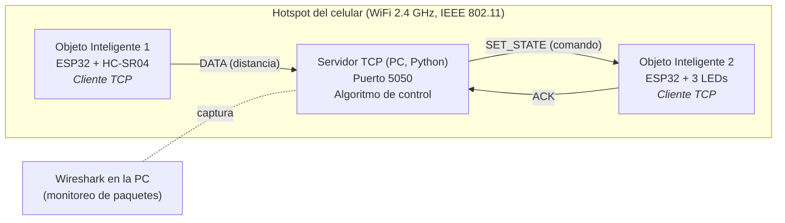
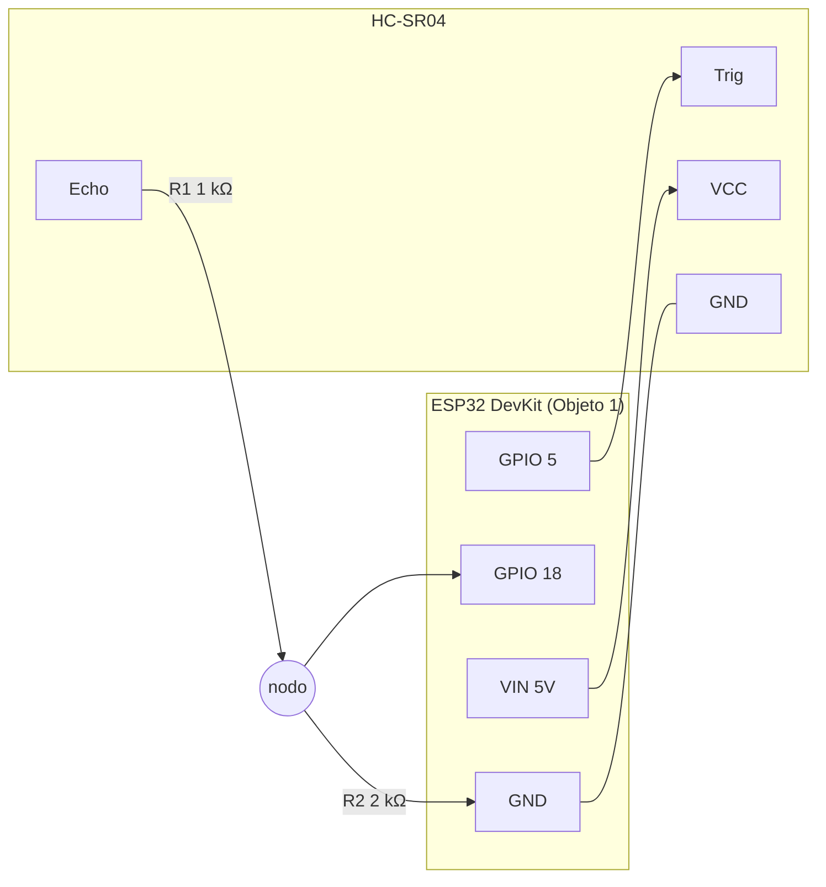
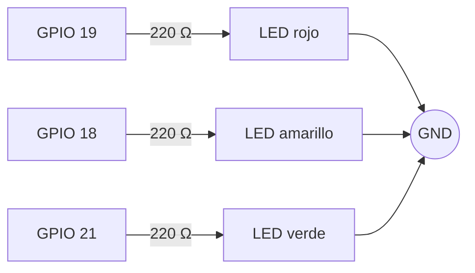
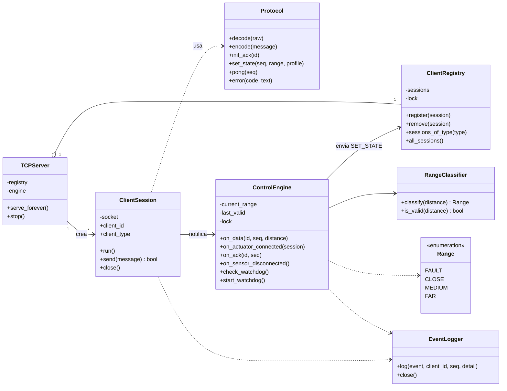
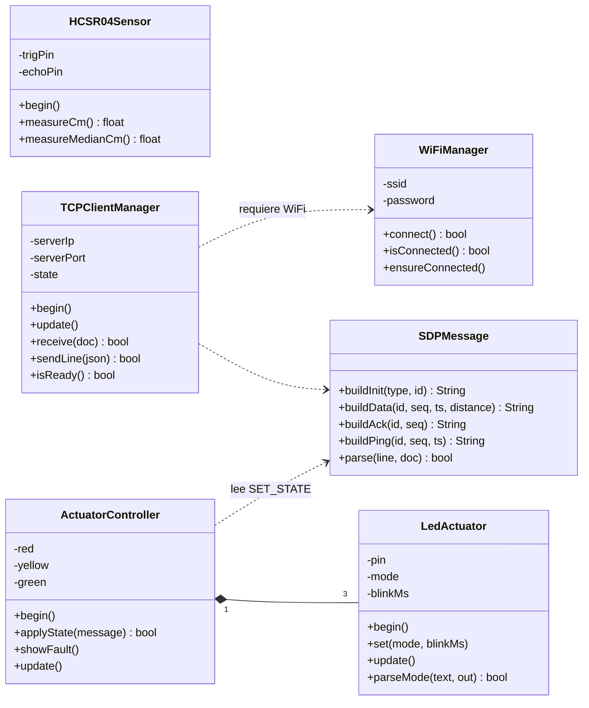
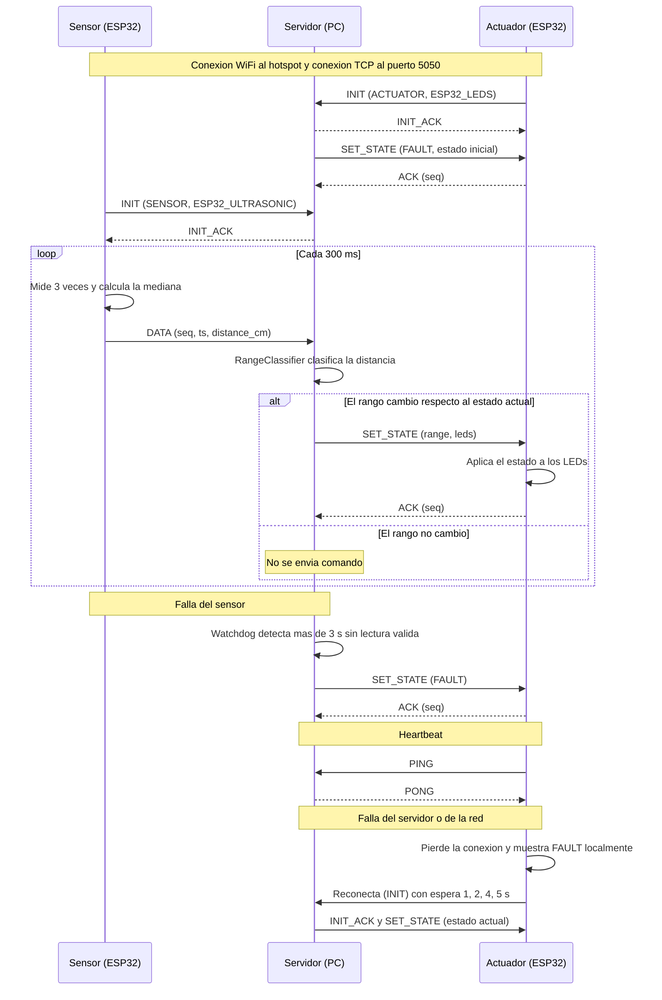

# Práctica 2 — Integración de Objetos Inteligentes con TCP/IP

| | |
|---|---|
| **Carrera** | Ingeniería de Sistemas |
| **Asignatura** | SIS-234 |
| **Integrantes** | `[Nombre 1]` · `[Nombre 2]` · `[Nombre 3]` |
| **Cuentas GitHub** | `[@usuario1]` · `[@usuario2]` · `[@usuario3]` |
| **Fecha de entrega** | Martes 13 de octubre de 2026 |
| **Versión del informe** | 1.0 |

## Índice

1. [Requerimientos Funcionales y No Funcionales](#1-requerimientos-funcionales-y-no-funcionales)
2. [Análisis y Diseño](#2-análisis-y-diseño)
3. [Desarrollo e Implementación](#3-desarrollo-e-implementación)
4. [Pruebas y Validaciones](#4-pruebas-y-validaciones)
5. [Resultados](#5-resultados)
6. [Conclusiones](#6-conclusiones)
7. [Recomendaciones](#7-recomendaciones)
8. [Anexos](#8-anexos)

---

## 1. Requerimientos Funcionales y No Funcionales

### 1.1 Descripción general

Sistema distribuido formado por dos objetos inteligentes (ESP32) y un servidor central (PC con Python). Un ESP32 mide distancia con un sensor ultrasónico HC-SR04 y la envía al servidor. El servidor clasifica la distancia en rangos y ordena a un segundo ESP32 el comportamiento de tres LEDs. Toda la comunicación usa **sockets TCP sobre WiFi (IEEE 802.11)** con un protocolo de aplicación propio, **SmartDistance Protocol (SDP)**.

Los dos ESP32 y la PC se conectan a la red WiFi creada por el **hotspot de un celular**, que actúa como punto de acceso y servidor DHCP.

### 1.2 Requerimientos funcionales

| ID | Requerimiento | Elemento de diseño que lo cubre |
|----|---------------|----------------------------------|
| RF1 | Medir la distancia entre el sensor ultrasónico y un objeto. | `HCSR04Sensor` (§2.3, §3.2) |
| RF2 | Clasificar la distancia en 3 rangos contiguos y sin solapamiento. | `RangeClassifier` (§2.7) |
| RF3 | Activar los actuadores con un comportamiento distinto por rango. | `ControlEngine`, `LED_PROFILES`, `ActuatorController` (§2.7) |
| RF4 | Sensor → servidor y servidor → actuador mediante sockets TCP sobre WiFi con protocolo de aplicación propio. | Protocolo SDP (§2.5), `TCPClientManager`, `TCPServer` |
| RF5 | Tratar lecturas inválidas (sin eco, fuera de rango) sin enviar valores falsos a los actuadores. | Mensaje `DATA` con `err`, validación 2–400 cm, estado `FAULT` (§2.5, §2.7) |
| RF6 | Recuperarse automáticamente si se cae el WiFi, el servidor o uno de los clientes. | Reconexión con espera creciente, `PING/PONG`, reemplazo de sesión (§2.5) |
| RF7 | Registrar los eventos del servidor con marcas de tiempo para poder medir latencias. | `EventLogger` (§3.2) |

### 1.3 Rangos de distancia y comportamiento (variante de 3 LEDs)

Intervalos contiguos y sin solapamiento (cerrado a la izquierda, abierto a la derecha):

| Estado | Intervalo de distancia `d` | LED rojo | LED amarillo | LED verde |
|--------|----------------------------|----------|--------------|-----------|
| `CLOSE` | `0 ≤ d < 15 cm` | Parpadea (150 ms) | Apagado | Apagado |
| `MEDIUM` | `15 ≤ d < 40 cm` | Apagado | Parpadea (500 ms) | Apagado |
| `FAR` | `d ≥ 40 cm` | Apagado | Apagado | Encendido fijo |
| `FAULT` (auxiliar) | Sin información confiable | Parpadea (500 ms) | Parpadea (500 ms) | Parpadea (500 ms) |

El valor de `blink_ms` es el tiempo encendido y también el tiempo apagado: el periodo completo del parpadeo es `2 × blink_ms` (rojo en `CLOSE`: 300 ms, ≈ 3,3 Hz; amarillo en `MEDIUM`: 1 s, 1 Hz).

`FAULT` no es un cuarto rango de distancia: es un estado de seguridad (los tres LEDs parpadean a la vez) que avisa que el sistema no tiene información confiable. Se activa en estos casos:

- **Al arrancar**: el servidor y el actuador comienzan en `FAULT` hasta recibir la primera lectura válida.
- **Sin lecturas válidas durante más de 3 s** (sensor desconectado, sin eco o sin datos): lo decide el servidor (*watchdog*).
- **El sensor cierra su conexión TCP**: el servidor pasa a `FAULT` de inmediato.
- **El actuador pierde la conexión con el servidor** (o el WiFi): el propio actuador muestra `FAULT` localmente, porque ya no conoce el estado real.

Los valores de borde (15 cm y 40 cm) pertenecen al rango superior: 15,0 cm es `MEDIUM` y 40,0 cm es `FAR`.

### 1.4 Requerimientos no funcionales (medibles)

| ID | Atributo | Valor declarado | Cómo se verifica |
|----|----------|-----------------|------------------|
| RNF1 | Estabilidad | Operación continua ≥ 10 min sin reinicios ni bloqueos (la prueba dura 15 min). | PT-08 |
| RNF2 | Exactitud de medición | Error ≤ ±3 cm respecto a cinta métrica en el **rango de trabajo 5 – 100 cm**. | PT-02 |
| RNF3 | Tiempo de respuesta | ≤ 1,0 s de extremo a extremo (sensor → servidor → actuador). | PT-06, PT-07 |
| RNF4 | Frecuencia de muestreo | ≥ 2 lecturas/s (diseño: 1 lectura cada 300 ms ≈ 3,3 Hz). | PT-05 |
| RNF5 | Recuperación | Reconexión automática en ≤ 10 s tras restablecerse la red o el servidor. | PT-09, PT-10 |
| RNF6 | Detección de falla | Entrada a `FAULT` en ≤ 3,5 s tras dejar de recibir lecturas válidas (3 s de timeout + 0,5 s del periodo del watchdog). | PT-11 |
| RNF7 | Calidad de código | Modular, orientado a objetos, documentado, con convenciones del lenguaje (PEP 8 en Python; C++/Arduino con una clase por par `.h/.cpp`). | Revisión de código |

### 1.5 Parámetros de configuración

| Parámetro | Valor | Dónde se define |
|-----------|-------|-----------------|
| Puerto TCP del servidor | `5050` | `main.py` (`--port`), `config.h` |
| Periodo de muestreo del sensor | 300 ms | `esp32_sensor/main.cpp` |
| Lecturas por muestra | 3 (se envía la mediana, separadas 10 ms) | `HCSR04Sensor::measureMedianCm` |
| Timeout de eco (`pulseIn`) | 25 ms (≈ 4,3 m) | `HCSR04Sensor.cpp` |
| Rango válido de lectura | 2,0 – 400,0 cm | `RangeClassifier` |
| Umbrales de rango | 15 cm y 40 cm | `RangeClassifier` |
| Timeout del sensor (`FAULT`) | 3 s (`--sensor-timeout`) | `main.py`, `ControlEngine` |
| Periodo del watchdog | 0,5 s | `ControlEngine.WATCHDOG_PERIOD_S` |
| Periodo de `PING` de los clientes | 5 s | `TCPClientManager` |
| Timeout sin `PONG` (cliente) / sin mensajes (servidor) | 15 s | `TCPClientManager`, `TCPServer` |
| Espera de reconexión TCP | 1 s, 2 s, 4 s, luego 5 s fijo | `TCPClientManager` |
| Reintento de WiFi | cada 5 s | `WiFiManager` |
| Timeout de conexión TCP / de `INIT_ACK` | 2 s / 5 s | `TCPClientManager` |
| Tamaño máximo de mensaje | 256 bytes | `protocol.py`, `TCPClientManager` |

---

## 2. Análisis y Diseño

### 2.1 Arquitectura del sistema

Arquitectura cliente-servidor centralizada sobre TCP/IP. Ambos objetos inician la conexión hacia el servidor; ninguno se comunica directamente con el otro.



Correspondencia con el modelo TCP/IP:

| Capa | Elemento usado |
|------|----------------|
| Aplicación | Protocolo SDP (JSON, un mensaje por línea) |
| Transporte | TCP, puerto 5050 (con `TCP_NODELAY` para reducir latencia) |
| Internet | IPv4 (direcciones asignadas por DHCP del hotspot) |
| Acceso a red | WiFi IEEE 802.11 b/g/n en 2,4 GHz |

### 2.2 Red y entorno (hotspot del celular)

- El **ESP32 solo soporta 2,4 GHz**. El hotspot debe estar en 2,4 GHz (iPhone: activar "Maximizar compatibilidad"; Android: elegir la banda de 2,4 GHz).
- La PC (servidor) y los dos ESP32 se conectan al mismo hotspot. Las IP se reparten por DHCP, por lo que **la IP de la PC puede cambiar entre sesiones**: el servidor la muestra al iniciar (y se puede consultar con `ipconfig`); se actualiza `SERVER_IP` en el `config.h` de cada ESP32 antes de la demo.
- El hotspot suele clasificarse como red *Pública* en Windows: hay que permitir el puerto en el firewall:
  ```
  netsh advfirewall firewall add rule name="SDP 5050" dir=in action=allow protocol=TCP localport=5050
  ```
- El tráfico es local (no consume datos móviles), pero el celular debe mantener el hotspot activo y conectado a la corriente.
- Las credenciales WiFi **no se suben al repositorio**: cada ESP32 usa un `config.h` listado en `.gitignore`, y se entrega un `config.example.h` como plantilla.

### 2.3 Diseño de hardware y circuitos

**Objeto Inteligente 1 — Sensor (ESP32 + HC-SR04)**

| HC-SR04 | ESP32 | Observación |
|---------|-------|-------------|
| VCC | VIN (5 V) | Alimentación desde USB |
| GND | GND | Tierra común |
| Trig | GPIO 5 | Salida del ESP32 (3,3 V es suficiente para disparar) |
| Echo | GPIO 18 | **Pasa por divisor de tensión** (1 kΩ en serie + 2 kΩ a GND) |

El pin Echo entrega 5 V y los GPIO del ESP32 toleran 3,3 V. El divisor entrega 5 V × 2 kΩ / (1 kΩ + 2 kΩ) ≈ 3,3 V.



**Objeto Inteligente 2 — Actuador (ESP32 + 3 LEDs)**

| LED | ESP32 | Resistencia | Observación |
|-----|-------|-------------|-------------|
| Rojo | GPIO 19 | 220 Ω en serie | Ánodo al GPIO (vía resistencia), cátodo a GND |
| Amarillo | GPIO 18 | 220 Ω en serie | Ídem |
| Verde | GPIO 21 | 220 Ω en serie | Ídem. Se usa GPIO 21 y no GPIO 5 (pin de arranque/*strapping*) para evitar destellos al encender. |



Corriente aproximada por LED rojo: (3,3 V − 1,8 V) / 220 Ω ≈ 7 mA, dentro del límite del GPIO.

> **[PENDIENTE]** Agregar los diagramas de circuito definitivos como imagen (`docs/circuito_sensor.png`, `docs/circuito_actuador.png`) y la fotografía del montaje real. Ver `GUIA_GRUPO.md`.

### 2.4 Diagrama de clases (estructural)

**Servidor (Python):**



**Clientes (ESP32, C++):**



El sensor usa `HCSR04Sensor`, `WiFiManager`, `TCPClientManager` y `SDPMessage`. El actuador usa `ActuatorController`, `LedActuator`, `WiFiManager`, `TCPClientManager` y `SDPMessage`.

### 2.5 Especificación del protocolo de aplicación: SmartDistance Protocol (SDP) v1

**Formato.** Un mensaje JSON por línea, codificación UTF-8, terminado en `\n`. Tamaño máximo de línea: 256 bytes. El servidor descarta las líneas más largas y responde `ERROR`. Como TCP es un flujo de bytes sin límites de mensaje, el `\n` es lo que delimita cada mensaje.

**Campos comunes.** `cmd` (obligatorio, identifica el mensaje), `id` (identificador del cliente), `seq` (entero que se incrementa por mensaje enviado), `ts` (milisegundos desde el arranque del ESP32, `millis()`).

| Mensaje | Dirección | Cuándo se envía | Campos obligatorios |
|---------|-----------|-----------------|---------------------|
| `INIT` | Cliente → Servidor | Al abrir la conexión | `type` (`SENSOR` o `ACTUATOR`), `id` |
| `INIT_ACK` | Servidor → Cliente | Respuesta al `INIT` | `id`, `status` |
| `DATA` | Sensor → Servidor | Cada 300 ms | `id`, `seq`, `ts`, `distance_cm` (número o `null`) |
| `SET_STATE` | Servidor → Actuador | Al cambiar de estado y al registrarse el actuador | `seq`, `range`, `led_red`, `led_yellow`, `led_green` (+ `blink_ms`) |
| `ACK` | Actuador → Servidor | Tras aplicar un `SET_STATE` válido | `id`, `seq` (el mismo del `SET_STATE`) |
| `PING` | Cliente → Servidor | Cada 5 s | `id`, `seq`, `ts` |
| `PONG` | Servidor → Cliente | Respuesta al `PING` | `seq` |
| `ERROR` | Servidor → Cliente | Mensaje inválido | `code`, `msg` |

**Ejemplos (cada línea termina en `\n`):**

```json
{"cmd":"INIT","type":"SENSOR","id":"ESP32_ULTRASONIC","ver":1}
{"cmd":"INIT","type":"ACTUATOR","id":"ESP32_LEDS","ver":1}
{"cmd":"INIT_ACK","id":"ESP32_ULTRASONIC","status":"OK"}
{"cmd":"DATA","id":"ESP32_ULTRASONIC","seq":120,"ts":36500,"distance_cm":24.5}
{"cmd":"DATA","id":"ESP32_ULTRASONIC","seq":121,"ts":36800,"distance_cm":null,"err":"NO_ECHO"}
{"cmd":"SET_STATE","seq":57,"range":"CLOSE","led_red":"BLINK","led_yellow":"OFF","led_green":"OFF","blink_ms":150}
{"cmd":"SET_STATE","seq":58,"range":"MEDIUM","led_red":"OFF","led_yellow":"BLINK","led_green":"OFF","blink_ms":500}
{"cmd":"SET_STATE","seq":59,"range":"FAR","led_red":"OFF","led_yellow":"OFF","led_green":"ON"}
{"cmd":"SET_STATE","seq":60,"range":"FAULT","led_red":"BLINK","led_yellow":"BLINK","led_green":"BLINK","blink_ms":500}
{"cmd":"ACK","id":"ESP32_LEDS","seq":57}
{"cmd":"PING","id":"ESP32_LEDS","seq":9,"ts":45000}
{"cmd":"PONG","seq":9}
{"cmd":"ERROR","code":"BAD_JSON","msg":"linea no valida"}
```

**Reglas del protocolo**

1. El cliente envía `INIT` apenas abre el socket; el servidor responde `INIT_ACK`. Hasta recibir `INIT_ACK` el cliente no envía otros mensajes.
2. Si se conecta un cliente con un `id` que ya tiene sesión activa, el servidor **cierra la sesión anterior** y conserva la nueva (caso típico: el ESP32 se reinició y la conexión vieja quedó a medias).
3. Tras `INIT_ACK` a un actuador, el servidor le envía de inmediato el **estado actual** (`SET_STATE`), de modo que un actuador que se reconecta queda sincronizado.
4. El campo `seq` de `SET_STATE` se repite en el `ACK` correspondiente, y el servidor mide con él el tiempo de ida y vuelta del comando.
5. Lectura inválida: el sensor envía `distance_cm: null` y `err: "NO_ECHO"` si no hubo eco dentro de 25 ms. El servidor considera inválido también cualquier valor fuera de 2,0 – 400,0 cm. Una lectura inválida no cambia el estado.
6. Si el servidor no recibe ningún mensaje de un cliente durante 15 s, cierra la sesión. Si un cliente no recibe `PONG` durante 15 s, cierra el socket y reconecta.
7. Solo el sensor puede enviar `DATA` y solo el actuador puede enviar `ACK`; de lo contrario el servidor responde `UNKNOWN_CMD`.
8. Códigos de `ERROR`: `BAD_JSON`, `UNKNOWN_CMD`, `MISSING_FIELD`, `LINE_TOO_LONG`, `NOT_REGISTERED`.

### 2.6 Diagrama de secuencia (comportamiento)



### 2.7 Lógica de control

El servidor mantiene el estado actual (`FAULT`, `CLOSE`, `MEDIUM`, `FAR`) y aplica estas reglas en `ControlEngine`:

1. Llega `DATA` con distancia válida (2 – 400 cm) → se actualiza el instante de la última lectura válida, se clasifica y, **solo si el estado cambió**, se envía `SET_STATE` al actuador.
2. Llega `DATA` inválido (`null` o fuera de rango) → se registra como `DATA_INVALID` y se mantiene el estado actual.
3. Un hilo *watchdog* revisa cada 0,5 s: si pasaron más de 3 s desde la última lectura válida, pasa a `FAULT` y lo envía al actuador.
4. Si el sensor cierra su conexión, el servidor pasa a `FAULT` de inmediato.
5. Cuando se conecta o reconecta el actuador, recibe el estado actual.
6. El estado es compartido entre hilos (uno por cliente, más el watchdog) y se protege con un `threading.RLock`; cada transición y su envío se hacen bajo el mismo candado, de modo que los comandos llegan al actuador en el orden en que se decidieron.

Clasificación (código real en [`control_engine.py`](src/server_python/control_engine.py)):

```python
def classify(self, distance_cm: float) -> Range:
    if distance_cm < self.CLOSE_MAX_CM:     # 15.0
        return Range.CLOSE
    if distance_cm < self.MEDIUM_MAX_CM:    # 40.0
        return Range.MEDIUM
    return Range.FAR
```

---

## 3. Desarrollo e Implementación

### 3.1 Estructura del repositorio

```
practica-2-iot/
├── README.md                    # Este informe
├── platformio.ini               # Entornos de compilación: sensor y actuator
├── .gitignore                   # Excluye config.h, logs/ y archivos generados
├── docs/
│   ├── (diagramas en imagen)
│   └── evidencias/              # Capturas de Wireshark, fotos, logs de pruebas
├── tools/
│   └── analizar_log.py          # Calcula métricas desde los CSV del servidor
└── src/
    ├── server_python/
    │   ├── main.py              # Punto de entrada
    │   ├── tcp_server.py        # TCPServer, ClientSession, ClientRegistry
    │   ├── protocol.py          # Protocol, ProtocolError
    │   ├── control_engine.py    # Range, LED_PROFILES, RangeClassifier, ControlEngine
    │   ├── event_logger.py      # EventLogger (CSV con marcas de tiempo)
    │   └── tests/
    │       └── test_integration.py
    ├── esp32_sensor/
    │   ├── main.cpp
    │   ├── config.example.h     # Plantilla (el config.h real no se sube)
    │   ├── HCSR04Sensor.h / .cpp
    │   ├── WiFiManager.h / .cpp
    │   ├── TCPClientManager.h / .cpp
    │   └── SDPMessage.h / .cpp
    └── esp32_actuator/
        ├── main.cpp
        ├── config.example.h
        ├── LedActuator.h / .cpp
        ├── ActuatorController.h / .cpp
        ├── WiFiManager.h / .cpp
        ├── TCPClientManager.h / .cpp
        └── SDPMessage.h / .cpp
```

Los ESP32 se programan con **PlatformIO** (`platformio.ini` define los entornos `sensor` y `actuator`, cada uno compila solo su carpeta). Por eso `WiFiManager`, `TCPClientManager` y `SDPMessage` están duplicados en las dos carpetas: cada firmware se compila de forma independiente (ver §7, recomendación 5).

### 3.2 Módulos y clases principales

**Servidor (Python 3.10+, solo biblioteca estándar)**

| Archivo | Clases | Responsabilidad |
|---------|--------|-----------------|
| [`tcp_server.py`](src/server_python/tcp_server.py) | `TCPServer`, `ClientSession`, `ClientRegistry` | Acepta conexiones (un hilo por cliente), lee líneas, registra sesiones con un candado, reemplaza sesiones duplicadas, activa `TCP_NODELAY` y aplica el timeout de inactividad de 15 s. |
| [`protocol.py`](src/server_python/protocol.py) | `Protocol`, `ProtocolError` | Convierte entre línea de texto y diccionario; valida campos, tipos y tamaño máximo. |
| [`control_engine.py`](src/server_python/control_engine.py) | `Range`, `RangeClassifier`, `ControlEngine` | Clasifica distancias, mantiene el estado, decide cuándo enviar `SET_STATE`, ejecuta el watchdog y calcula el RTT de cada `ACK`. Contiene `LED_PROFILES` (comportamiento de los LEDs por estado). |
| [`event_logger.py`](src/server_python/event_logger.py) | `EventLogger` | Escribe un CSV (`logs/sdp_<fecha>.csv`) con columnas `timestamp`, `mono_ms`, `event`, `client_id`, `seq`, `detail`. |
| [`tests/test_integration.py`](src/server_python/tests/test_integration.py) | `TestRangeClassifier`, `TestServer` | 14 pruebas automáticas con un sensor y un actuador simulados: rangos, bordes, `FAULT`, reconexión, sesión duplicada, `PING/PONG`, RTT y errores del protocolo. |

**Cliente sensor (ESP32, C++/Arduino)**

| Archivo | Clase | Responsabilidad |
|---------|-------|-----------------|
| [`HCSR04Sensor.cpp`](src/esp32_sensor/HCSR04Sensor.cpp) | `HCSR04Sensor` | Genera el pulso en Trig, mide el eco con `pulseIn` (timeout 25 ms), convierte a cm (`t_µs × 0,0343 / 2`) y calcula la mediana de 3 lecturas. |
| [`WiFiManager.cpp`](src/esp32_sensor/WiFiManager.cpp) | `WiFiManager` | Conecta al hotspot (sin ahorro de energía) y reintenta cada 5 s si se pierde la señal, sin bloquear. |
| [`TCPClientManager.cpp`](src/esp32_sensor/TCPClientManager.cpp) | `TCPClientManager` | Máquina de estados (`DISCONNECTED`, `WAIT_INIT_ACK`, `READY`): abre el socket, activa `setNoDelay(true)`, envía `INIT`, lee líneas sin bloquear, envía `PING` y vigila el `PONG`, y reconecta con espera creciente. |
| [`SDPMessage.cpp`](src/esp32_sensor/SDPMessage.cpp) | `SDPMessage` | Construye y analiza mensajes con la biblioteca ArduinoJson v7. |
| [`main.cpp`](src/esp32_sensor/main.cpp) | — | `setup()` y `loop()`: muestrea cada 300 ms y envía `DATA`. |

**Cliente actuador (ESP32, C++/Arduino)**

| Archivo | Clase | Responsabilidad |
|---------|-------|-----------------|
| [`LedActuator.cpp`](src/esp32_actuator/LedActuator.cpp) | `LedActuator` | Controla un LED en modo `OFF`, `ON` o `BLINK`. El parpadeo es **no bloqueante** (usa `millis()`), de modo que el socket se sigue atendiendo mientras parpadea. |
| [`ActuatorController.cpp`](src/esp32_actuator/ActuatorController.cpp) | `ActuatorController` | Agrupa los 3 LEDs, valida y aplica un `SET_STATE` y muestra `FAULT` como estado de seguridad. |
| [`main.cpp`](src/esp32_actuator/main.cpp) | — | Recibe `SET_STATE`, responde `ACK` y muestra `FAULT` si pierde la conexión con el servidor. |
| `WiFiManager`, `TCPClientManager`, `SDPMessage` | (igual que el sensor) | |

### 3.3 Fragmentos clave

**Parpadeo no bloqueante** ([`LedActuator.cpp`](src/esp32_actuator/LedActuator.cpp)): en vez de `delay()`, cada vuelta de `loop()` compara `millis()` con el último cambio y solo invierte el LED cuando ya pasó `blinkMs_`. Así el ESP32 sigue leyendo el socket y respondiendo `PING/PONG` mientras parpadea.

```cpp
void LedActuator::update() {
  if (mode_ != LedMode::BLINK) return;
  const unsigned long now = millis();
  if (now - lastToggleMs_ >= blinkMs_) {
    level_ = !level_;
    digitalWrite(pin_, level_ ? HIGH : LOW);
    lastToggleMs_ = now;
  }
}
```

**Medición de distancia** ([`HCSR04Sensor.cpp`](src/esp32_sensor/HCSR04Sensor.cpp)): pulso de 10 µs en Trig, medición del ancho del pulso de Echo y conversión a cm. El sonido recorre ida y vuelta, por eso se divide entre 2.

```cpp
const unsigned long durationUs = pulseIn(echoPin_, HIGH, kEchoTimeoutUs);  // 25 ms
if (durationUs == 0) return NAN;                                           // sin eco
return static_cast<float>(durationUs) * kSoundCmPerUs / 2.0f;              // 0,0343 cm/µs
```

**Envío de un mensaje por TCP** ([`TCPClientManager.cpp`](src/esp32_sensor/TCPClientManager.cpp)): el JSON se arma con `SDPMessage`, se le agrega `\n` y se escribe en el socket.

```cpp
bool TCPClientManager::writeLine(const String& json) {
  String out = json;
  out += '\n';                         // delimitador de mensaje en SDP
  const size_t written = client_.write(reinterpret_cast<const uint8_t*>(out.c_str()), out.length());
  if (written != out.length()) { drop("error de escritura"); return false; }
  return true;
}
```

**Decisión de cambio de estado** ([`control_engine.py`](src/server_python/control_engine.py)): solo se envía `SET_STATE` si el estado realmente cambió.

```python
def _transition_locked(self, new_range, reason=""):
    if new_range is self._range:
        return                                   # sin cambio: no se envia nada
    old, self._range = self._range, new_range
    self._logger.log("STATE_CHANGE", seq="", detail=f"{old.value}->{new_range.value} {reason}".strip())
    self._send_state_locked(self._registry.sessions_of_type("ACTUATOR"))
```

### 3.4 Decisiones de diseño

| Decisión | Justificación |
|----------|---------------|
| TCP con `TCP_NODELAY` | Los mensajes son pequeños y frecuentes; el algoritmo de Nagle podría retrasarlos y afectar RNF3. |
| JSON por líneas | Legible en Wireshark (*Follow TCP Stream*), fácil de depurar y de extender. |
| Mediana de 3 lecturas | Descarta lecturas espurias del HC-SR04 y ayuda a cumplir RNF2. |
| `SET_STATE` solo al cambiar de estado | Reduce tráfico; el estado actual se reenvía al reconectar el actuador, así que no se pierde sincronía. |
| Parpadeo ejecutado en el actuador | El servidor no tiene que enviar comandos periódicos y el parpadeo no depende de la latencia de red. |
| Estado `FAULT` (servidor y actuador) | Evita mostrar un rango falso cuando no hay información confiable. |
| Un hilo por cliente y un watchdog | Un cliente lento o caído no bloquea al otro; el watchdog detecta la falta de datos aunque no llegue ningún mensaje. |
| `config.h` fuera del repositorio | No se publican credenciales WiFi. |

### 3.5 Entorno y ejecución

**Servidor** (Python 3.10 o superior, sin dependencias externas):

```
cd src/server_python
python main.py              # opciones: --port 5050 --log-dir logs --sensor-timeout 3.0 --quiet
```

Al iniciar, el servidor imprime la IP probable de la PC (la que va en `SERVER_IP` de los ESP32).

**ESP32** (PlatformIO, biblioteca ArduinoJson v7 declarada en `platformio.ini`):

1. Copiar `config.example.h` a `config.h` en cada carpeta (`esp32_sensor` y `esp32_actuator`) y completar `WIFI_SSID`, `WIFI_PASSWORD` y `SERVER_IP`.
2. Ajustar `upload_port` y `monitor_port` en `platformio.ini` al puerto COM de cada placa.
3. Compilar y cargar: `pio run -e sensor -t upload` y `pio run -e actuator -t upload`.
4. Monitor serie: `pio device monitor -e sensor` (o `-e actuator`).

**Orden de arranque:** activar hotspot → conectar la PC → iniciar el servidor y anotar su IP → actualizar `SERVER_IP` si cambió (y volver a cargar) → encender los ESP32.

**Pruebas automáticas del servidor** (sin hardware): desde `src/server_python`, `python -m unittest discover -s tests -v`.

---

## 4. Pruebas y Validaciones

### 4.1 Instrumentos y método

- **Cinta métrica y superficie plana** (una caja o pared) como referencia física para la exactitud.
- **Wireshark en la PC**, capturando en la interfaz WiFi conectada al hotspot. Como el servidor está en la misma PC, la captura ve todo el tráfico de los dos ESP32. Filtros útiles:
  - `tcp.port == 5050` (todo el sistema).
  - `ip.addr == <IP_sensor> && tcp.port == 5050` (solo el sensor).
  - `tcp.port == 5050 && tcp.len > 0` (solo paquetes con datos).
  - Clic derecho → *Follow → TCP Stream* para leer los mensajes JSON completos.
- **Registro del servidor** (`logs/sdp_*.csv`), procesado con [`tools/analizar_log.py`](tools/analizar_log.py).
- **Monitor serie** de cada ESP32, para ver la distancia medida y los estados.
- Todas las evidencias se guardan en `docs/evidencias/`.

### 4.2 Plan de pruebas

| ID | Requisito | Procedimiento | Criterio de aceptación | Evidencia |
|----|-----------|---------------|------------------------|-----------|
| PT-01 | RF1 | Colocar un obstáculo a distancias conocidas y leer el monitor serie. | El sensor entrega valores coherentes. | Captura del monitor serie |
| PT-02 | RF1, RNF2 | Medir a 5, 10, 15, 20, 30, 40, 50, 75 y 100 cm con cinta métrica; tomar 10 lecturas por punto. | Error máximo ≤ ±3 cm en todo el rango 5 – 100 cm. | Tabla 5.1 |
| PT-03 | RF2, RF3 | Colocar el obstáculo a 8, 25 y 60 cm (un punto por rango). | `CLOSE`: rojo parpadea; `MEDIUM`: amarillo parpadea; `FAR`: verde fijo. | Foto/video, log |
| PT-04 | RF2, RF3 | Valores límite: acercar y alejar el obstáculo cruzando 15 cm y 40 cm; verificar la clasificación con los valores de borde. | 15,0 → `MEDIUM`; 40,0 → `FAR`; sin solapamiento ni estados intermedios. | Log, Tabla 5.2 |
| PT-05 | RF4, RNF4 | Dejar el sistema 60 s y contar los mensajes `DATA` (log y captura de Wireshark). | ≥ 2 lecturas/s (esperado ≈ 3,3). | Log, captura `.pcapng` |
| PT-06 | RF4, RNF3 | Con el log del servidor, medir ∆t entre `DATA` y `SET_STATE_SENT`, y el RTT `SET_STATE` → `ACK`. | ∆t del servidor y RTT con el actuador reportados (Tabla 5.3). | Log, captura |
| PT-07 | RNF3 | Cambio de rango real con el obstáculo: grabar en cámara lenta desde que el obstáculo cruza el umbral hasta que cambia el LED. Repetir 10 veces. | Tiempo extremo a extremo ≤ 1,0 s en las 10 repeticiones. | Videos, Tabla 5.3 |
| PT-08 | RNF1 | Sistema funcionando 15 min moviendo el obstáculo entre los 3 rangos. | Sin reinicios, bloqueos ni pérdida de conexión. | Log, captura |
| PT-09 | RF6, RNF5 | Reiniciar el servidor con los clientes encendidos. | Los dos clientes reconectan en ≤ 10 s y el actuador vuelve al estado correcto. | Log, monitor serie |
| PT-10 | RF6, RNF5 | Apagar y volver a encender el hotspot. | Los ESP32 reconectan WiFi y TCP en ≤ 10 s. | Log, monitor serie |
| PT-11 | RF5, RNF6 | Desconectar el cable de Echo con el sistema en marcha. | En ≤ 3,5 s el actuador entra a `FAULT` (3 LEDs parpadeando); al reconectar vuelve al rango real. | Video, log |
| PT-12 | RF5 | Apuntar el sensor al aire (sin eco) y a un objeto a < 2 cm. | Las lecturas inválidas no cambian el estado antes de 3 s. | Log |
| PT-13 | RF4 | Enviar manualmente un mensaje JSON inválido al servidor. | El servidor responde `ERROR` y sigue operando. | Captura, log |
| PT-14 | RF4 | Verificar con *Follow TCP Stream* que los mensajes cumplen el formato SDP (JSON, `\n`, campos). | Cumple §2.5. | Captura |
| PT-15 | RF2, RF3, RF5, RF6 | Ejecutar `python -m unittest discover -s tests -v` en el servidor. | 14 de 14 pruebas aprobadas. | Salida de consola |

### 4.3 Ejecución de pruebas

| ID | Fecha | Responsable | Resultado (Aprobada / Falló) | Observaciones |
|----|-------|-------------|------------------------------|---------------|
| PT-01 | `[PENDIENTE]` | | | |
| PT-02 | `[PENDIENTE]` | | | |
| PT-03 | `[PENDIENTE]` | | | |
| PT-04 | `[PENDIENTE]` | | | |
| PT-05 | `[PENDIENTE]` | | | |
| PT-06 | `[PENDIENTE]` | | | |
| PT-07 | `[PENDIENTE]` | | | |
| PT-08 | `[PENDIENTE]` | | | |
| PT-09 | `[PENDIENTE]` | | | |
| PT-10 | `[PENDIENTE]` | | | |
| PT-11 | `[PENDIENTE]` | | | |
| PT-12 | `[PENDIENTE]` | | | |
| PT-13 | `[PENDIENTE]` | | | |
| PT-14 | `[PENDIENTE]` | | | |
| PT-15 | `[PENDIENTE]` | | | |

### 4.4 Presupuesto de tiempo esperado (RNF3)

Análisis previo a la medición, para saber qué esperar:

| Etapa | Tiempo máximo esperado |
|-------|------------------------|
| Espera hasta el siguiente muestreo (peor caso, periodo de 300 ms) | 300 ms |
| Medición (3 lecturas con mediana y pausas de 10 ms) | ≈ 20 – 60 ms |
| Sensor → servidor (WiFi + TCP) | ≈ 10 – 50 ms |
| Procesamiento en el servidor | < 5 ms |
| Servidor → actuador (WiFi + TCP) | ≈ 10 – 50 ms |
| Aplicación del estado en el LED | < 5 ms |
| **Total peor caso estimado** | **≈ 0,5 s** |

El margen respecto a 1,0 s es de aproximadamente 0,5 s. Las cifras de red son estimaciones y se contrastan con las medidas de PT-06 y PT-07 en la sección 5.

---

## 5. Resultados

> **[PENDIENTE]** Se llena con los datos reales de las pruebas (ver `GUIA_GRUPO.md`). No se incluyen valores inventados.

### 5.1 Exactitud de medición (PT-02)

| Distancia real (cm) | Promedio medido (cm) | Error máx. (cm) | ¿≤ ±3 cm? |
|---------------------|----------------------|------------------|-----------|
| 5 | | | |
| 10 | | | |
| 15 | | | |
| 20 | | | |
| 30 | | | |
| 40 | | | |
| 50 | | | |
| 75 | | | |
| 100 | | | |

### 5.2 Clasificación en valores límite (PT-04)

| Distancia medida (cm) | Estado esperado | Estado obtenido |
|-----------------------|-----------------|-----------------|
| 14,9 | `CLOSE` | |
| 15,0 | `MEDIUM` | |
| 39,9 | `MEDIUM` | |
| 40,0 | `FAR` | |

### 5.3 Tiempos de respuesta y frecuencia de muestreo (PT-05, PT-06, PT-07)

| Medida | Valor obtenido | Límite |
|--------|----------------|--------|
| Lecturas por segundo (promedio de 60 s) | | ≥ 2 |
| ∆t `DATA` → `SET_STATE` en el servidor (promedio / máx.) | | (informativo) |
| RTT `SET_STATE` → `ACK` (promedio / máx.) | | (informativo) |
| Tiempo extremo a extremo (promedio / máx. de 10 repeticiones) | | ≤ 1,0 s |

### 5.4 Estabilidad y recuperación (PT-08 a PT-11)

| Prueba | Resultado |
|--------|-----------|
| Operación continua (duración real) | |
| Reconexión tras reinicio del servidor (tiempo) | |
| Reconexión tras reinicio del hotspot (tiempo) | |
| Entrada a `FAULT` tras desconectar el sensor (tiempo) | |

### 5.5 Análisis de errores

`[PENDIENTE]`

---

## 6. Conclusiones

`[PENDIENTE]`

---

## 7. Recomendaciones

Recomendaciones técnicas desde el diseño (se ajustan con los resultados reales):

1. **Histéresis en los umbrales.** Cerca de 15 cm y 40 cm, una lectura que oscila puede hacer cambiar el estado repetidamente. Una histéresis de 1 – 2 cm (cambiar de rango solo si se supera el umbral por ese margen) reduce el parpadeo en el borde. No se aplicó para que la clasificación sea exactamente la definida en §1.3.
2. **Sin eco no siempre significa falla.** Al apuntar a un espacio abierto, el HC-SR04 no recibe eco y reporta `NO_ECHO`; en este diseño eso termina en `FAULT` después de 3 s. Si la aplicación necesitara tratarlo como "muy lejos", habría que distinguirlo de un sensor desconectado.
3. **Compensar la temperatura.** El código usa 343 m/s (20 °C). La velocidad del sonido aumenta con la temperatura (≈ 0,6 m/s por °C), por lo que a temperaturas altas la distancia se subestima ligeramente; un sensor de temperatura permitiría corregirlo.
4. **Sincronizar relojes** (por ejemplo, con NTP) para medir la latencia unidireccional entre el ESP32 y el servidor sin depender solo del reloj de la PC.
5. **Reutilizar código común** (`WiFiManager`, `TCPClientManager`, `SDPMessage`) como biblioteca compartida de PlatformIO (`lib/`) en lugar de duplicarlo en cada firmware.
6. **Cifrado y autenticación.** SDP viaja en texto plano; para un uso real se recomienda TLS y un identificador/clave por dispositivo.
7. **Fijar la IP del servidor** con un router que permita reservas DHCP, para no editar `config.h` en cada sesión (el hotspot del celular no lo permite).
8. **Alimentación estable** para los ESP32 (cargador de buena calidad), ya que las caídas de tensión afectan el WiFi y las lecturas.

> **[PENDIENTE]** Añadir recomendaciones derivadas de los problemas reales encontrados durante las pruebas.

---

## 8. Anexos

| Anexo | Contenido | Ubicación |
|-------|-----------|-----------|
| A | Diagramas (arquitectura, circuitos, clases, secuencia) en imagen | `docs/` `[PENDIENTE]` |
| B | Fotografías del montaje de cada objeto inteligente | `docs/evidencias/` `[PENDIENTE]` |
| C | Capturas de Wireshark (`.pcapng` y capturas de pantalla) | `docs/evidencias/` `[PENDIENTE]` |
| D | Logs del servidor (CSV) de las pruebas | `docs/evidencias/` `[PENDIENTE]` |
| E | Videos o enlaces de la demostración | `[PENDIENTE]` |
| F | Hojas de datos del HC-SR04 y del ESP32 | Enlaces del fabricante |
| G | Reparto de trabajo por integrante | Tabla siguiente |

**Reparto de trabajo:**

| Integrante | Módulos / tareas | Cuenta GitHub |
|------------|------------------|---------------|
| `[Nombre 1]` | `[PENDIENTE]` | `[@usuario1]` |
| `[Nombre 2]` | `[PENDIENTE]` | `[@usuario2]` |
| `[Nombre 3]` | `[PENDIENTE]` | `[@usuario3]` |
