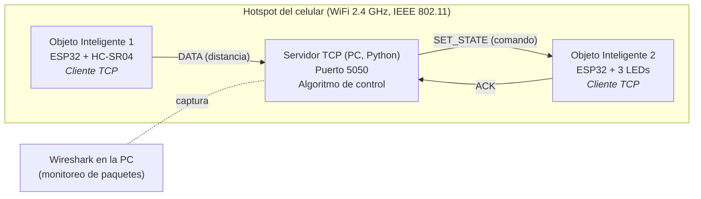
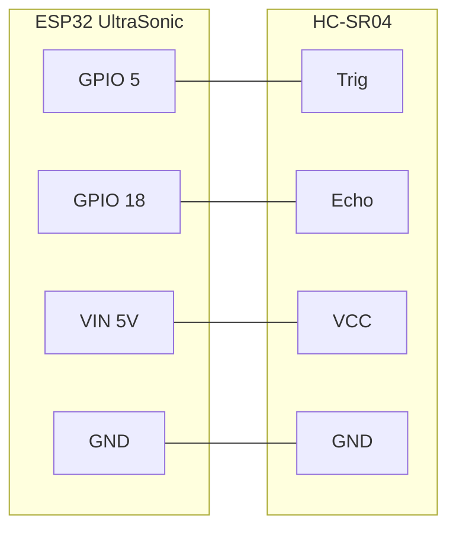
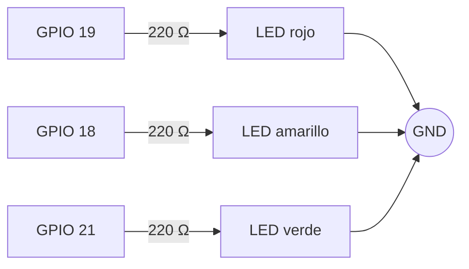
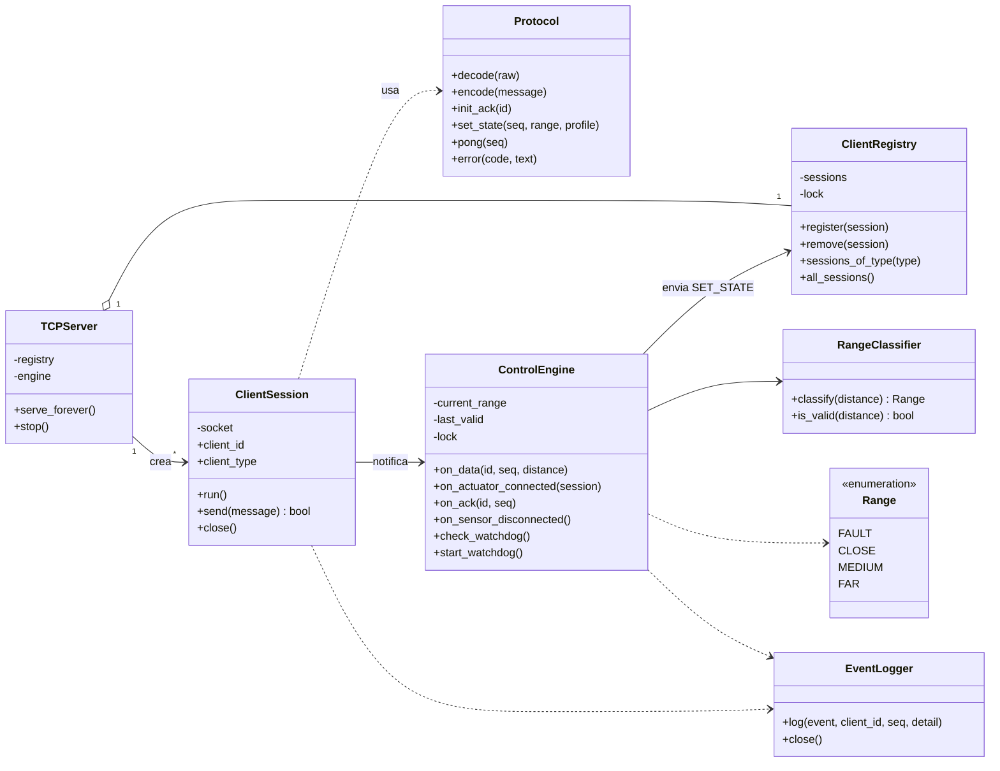
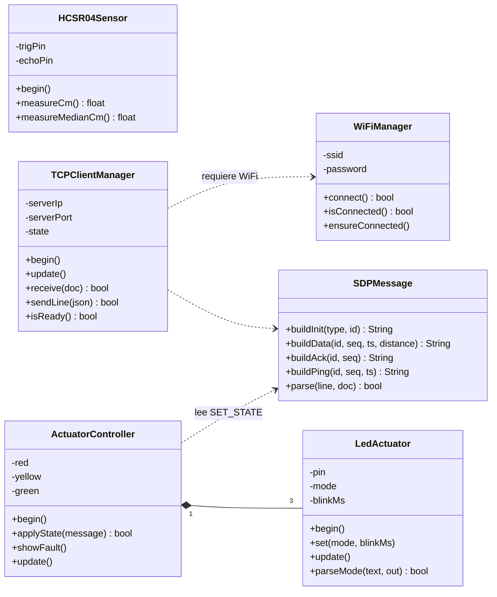
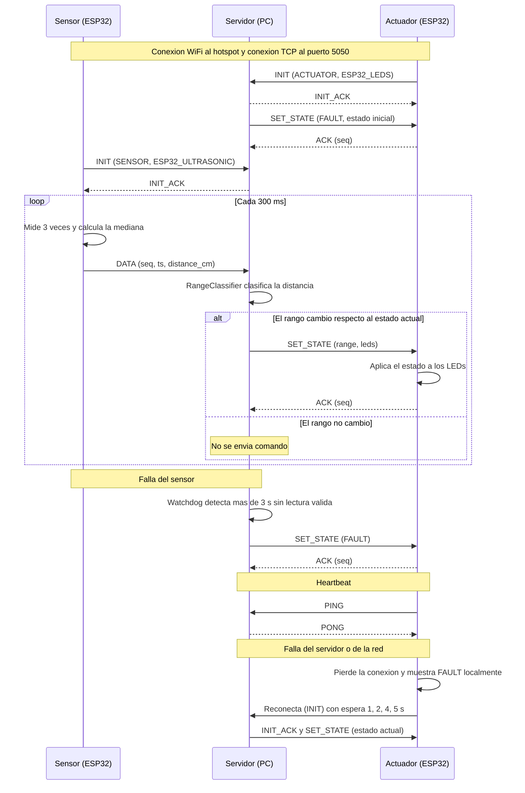

# Práctica 2 — Integración de Objetos Inteligentes con TCP/IP

| | |
|---|---|
| **Carrera** | Ingeniería de Sistemas |
| **Asignatura** | SIS-234 |
| **Integrantes** | Jesús Ariel Mamani Gutierrez · Leonardo Koller Mejia · Luis Felipe Velasco Lopez |
| **Cuentas GitHub** | [@JesusxAriel](https://github.com/JesusxAriel) · [@leoGKM](https://github.com/leoGKM) · [@feliLuis](https://github.com/feliLuis) |
| **Repositorio** | [Practica2IoTGrupo7](https://github.com/JesusxAriel/Practica2IoTGrupo7) |
| **Fecha de entrega** | Martes 13 de octubre de 2026 |
| **Versión del informe** | 1.0 |

## Resumen

Este informe documenta el diseño, la implementación y la validación de un sistema distribuido formado por dos objetos inteligentes ESP32 y un servidor Python que se comunican por sockets TCP con un protocolo propio (SDP). Un sensor ultrasónico HC-SR04 mide la distancia; el servidor la clasifica en `CLOSE`, `MEDIUM` o `FAR` y ordena a un actuador con tres LEDs el comportamiento correspondiente, con un estado de seguridad `FAULT` cuando no hay información confiable.

Se ejecutaron 12 casos de prueba (PT-01 a PT-12) y todos quedaron aprobados (§4). Resultados principales:

| Aspecto | Resultado observado | Requisito |
|---------|---------------------|-----------|
| Exactitud de medición (PT-02) | Error máximo de 1,03 cm en 5 – 100 cm | ≤ ±3 cm |
| Frecuencia de muestreo (PT-05) | 183 lecturas en 60 s ≈ 3,05 lecturas/s | ≥ 2 lecturas/s |
| Respuesta de extremo a extremo (PT-07) | Máximo medido de 0,3 s | ≤ 1,0 s |
| Reconexión tras reinicio del servidor (PT-08) | ≈ 3 s | ≤ 10 s |
| Entrada a `FAULT` (PT-09) | ≈ 3 s | ≤ 3,5 s |
| Pruebas automáticas (PT-12) | 14 ejecutadas, 0 fallos | Sin fallos |

---

## Índice

1. [Requerimientos Funcionales y No Funcionales](#1-requerimientos-funcionales-y-no-funcionales)
2. [Análisis y Diseño](#2-análisis-y-diseño)
3. [Desarrollo e Implementación](#3-desarrollo-e-implementación)
4. [Pruebas y Validaciones](#4-pruebas-y-validaciones)
5. [Resultados](#5-resultados)
6. [Conclusiones](#6-conclusiones)
7. [Recomendaciones](#7-recomendaciones)
8. [Anexos](#8-anexos)

---

## 1. Requerimientos Funcionales y No Funcionales

### 1.1 Descripción general

Sistema distribuido formado por dos objetos inteligentes (ESP32) y un servidor central (PC con Python). Un ESP32 mide distancia con un sensor ultrasónico HC-SR04 y la envía al servidor. El servidor clasifica la distancia en rangos y ordena a un segundo ESP32 el comportamiento de tres LEDs. Toda la comunicación usa **sockets TCP sobre WiFi (IEEE 802.11)** con un protocolo de aplicación propio, **SmartDistance Protocol (SDP)**.

Los dos ESP32 y la PC se conectan a la red WiFi creada por el **hotspot de un celular**, que actúa como punto de acceso y servidor DHCP.

### 1.2 Requerimientos funcionales

| ID | Requerimiento | Elemento de diseño que lo cubre |
|----|---------------|----------------------------------|
| RF1 | Medir la distancia entre el sensor ultrasónico y un objeto. | `HCSR04Sensor` (§2.3, §3.2) |
| RF2 | Clasificar la distancia en 3 rangos contiguos y sin solapamiento. | `RangeClassifier` (§2.7) |
| RF3 | Activar los actuadores con un comportamiento distinto por rango. | `ControlEngine`, `LED_PROFILES`, `ActuatorController` (§2.7) |
| RF4 | Sensor → servidor y servidor → actuador mediante sockets TCP sobre WiFi con protocolo de aplicación propio. | Protocolo SDP (§2.5), `TCPClientManager`, `TCPServer` |
| RF5 | Tratar las lecturas inválidas sin enviar valores falsos al actuador y pasar a `FAULT` solo ante una ausencia prolongada de lecturas válidas (ver §1.2.1). | Mensaje `DATA` con `err`, validación 2–400 cm, estado `FAULT` (§2.5, §2.7) |
| RF6 | Recuperarse automáticamente si se cae el WiFi, el servidor o uno de los clientes. | Reconexión con espera creciente, `PING/PONG`, reemplazo de sesión (§2.5) |
| RF7 | Registrar los eventos del servidor con marcas de tiempo para poder medir latencias. | `EventLogger` (§3.2) |

### 1.2.1 Tratamiento de las lecturas inválidas (RF5)

| Situación | Qué significa | Tratamiento |
|-----------|---------------|-------------|
| **Lectura válida** | Distancia dentro del rango admitido de 2,0 – 400,0 cm. | Se clasifica y actualiza el instante de la última lectura válida. |
| **Ausencia de eco** | El sensor intenta medir, pero no obtiene una respuesta válida dentro del timeout de 25 ms. Por sí sola no permite determinar la causa (objeto fuera de alcance, superficie que no refleja, sensor desconectado, etc.). | El sensor envía `distance_cm: null` con `err: "NO_ECHO"`. El servidor la registra como `DATA_INVALID`, mantiene el estado y no envía ningún valor al actuador. |
| **Medición fuera del rango admitido** | Valor menor de 2,0 cm o mayor de 400,0 cm. | No se acepta como distancia válida; recibe el mismo tratamiento que la ausencia de eco. |
| **Ausencia prolongada de lecturas válidas** | Transcurren más de 3 s (`--sensor-timeout`) sin ninguna lectura válida. | El *watchdog* (revisa cada 0,5 s) activa `FAULT`; se espera en ≤ 3,5 s. |

Una lectura inválida aislada **no** activa `FAULT`: solo lo hace la ausencia sostenida de lecturas válidas (o las demás causas de §1.3). Tampoco debe interpretarse la falta de eco como que no existe un objeto.

### 1.3 Rangos de distancia y comportamiento (variante de 3 LEDs)

Intervalos contiguos y sin solapamiento (cerrado a la izquierda, abierto a la derecha):

| Estado | Intervalo de distancia `d` | LED rojo | LED amarillo | LED verde |
|--------|----------------------------|----------|--------------|-----------|
| `CLOSE` | `0 ≤ d < 15 cm` | Parpadea (150 ms) | Apagado | Apagado |
| `MEDIUM` | `15 ≤ d < 40 cm` | Apagado | Parpadea (500 ms) | Apagado |
| `FAR` | `d ≥ 40 cm` | Apagado | Apagado | Encendido fijo |
| `FAULT` (auxiliar) | Sin información confiable | Parpadea (500 ms) | Parpadea (500 ms) | Parpadea (500 ms) |

El valor de `blink_ms` es el tiempo encendido y también el tiempo apagado: el periodo completo del parpadeo es `2 × blink_ms` (rojo en `CLOSE`: 300 ms, ≈ 3,3 Hz; amarillo en `MEDIUM`: 1 s, 1 Hz).

`FAULT` no es un cuarto rango de distancia: es un estado de seguridad (los tres LEDs parpadean a la vez) que avisa que el sistema no tiene información confiable. Se activa en estos casos:

- **Al arrancar**: el servidor y el actuador comienzan en `FAULT` hasta recibir la primera lectura válida.
- **Sin lecturas válidas durante más de 3 s** (sensor desconectado, sin eco o sin datos): lo decide el servidor (*watchdog*).
- **El sensor cierra su conexión TCP**: el servidor pasa a `FAULT` de inmediato.
- **El actuador pierde la conexión con el servidor** (o el WiFi): el propio actuador muestra `FAULT` localmente, porque ya no conoce el estado real.

Los valores de borde (15 cm y 40 cm) pertenecen al rango superior: 15,0 cm es `MEDIUM` y 40,0 cm es `FAR`.

### 1.4 Requerimientos no funcionales (medibles)

| ID | Atributo | Valor declarado | Cómo se verifica |
|----|----------|-----------------|------------------|
| RNF1 | Estabilidad | Funcionamiento normal ≥ 10 min sin reinicios ni bloqueos. La sesión de prueba dura 15 min: 10 min de funcionamiento normal y 5 min de fallos provocados intencionalmente (caída del sensor o del servidor). | PT-08 |
| RNF2 | Exactitud de medición | Error ≤ ±3 cm respecto a un flexómetro (instrumento de referencia) en el **rango de trabajo 5 – 100 cm**. No se verifica la exactitud en el resto del rango del sensor (2 – 400 cm). | PT-02 |
| RNF3 | Tiempo de respuesta | ≤ 1,0 s de extremo a extremo (sensor → servidor → actuador). | PT-06 (métricas de latencia del servidor) y PT-07 (medición en cámara lenta) |
| RNF4 | Frecuencia de muestreo | ≥ 2 lecturas/s (diseño: 1 lectura cada 300 ms ≈ 3,3 Hz). | PT-05 (conteo de lecturas en 60 s) |
| RNF5 | Recuperación | Reconexión automática en ≤ 10 s tras restablecerse la red o el servidor. | PT-08 (reinicio del servidor) |
| RNF6 | Detección de falla | Entrada a `FAULT` en ≤ 3,5 s tras dejar de recibir lecturas válidas (3 s de timeout + 0,5 s del periodo del watchdog). | PT-09 (cronometraje manual) |
| RNF7 | Calidad de código | Modular, orientado a objetos, documentado, con convenciones del lenguaje (PEP 8 en Python; C++/Arduino con una clase por par `.h/.cpp`). | Inspección del código fuente (§3) |

### 1.5 Parámetros de configuración

| Parámetro | Valor | Dónde se define |
|-----------|-------|-----------------|
| Puerto TCP del servidor | `5050` | `main.py` (`--port`), `config.h` |
| Periodo de muestreo del sensor | 300 ms | `esp32_sensor/main.cpp` |
| Lecturas por muestra | 3 (se envía la mediana, separadas 10 ms) | `HCSR04Sensor::measureMedianCm` |
| Timeout de eco (`pulseIn`) | 25 ms (≈ 4,3 m) | `HCSR04Sensor.cpp` |
| Rango válido de lectura | 2,0 – 400,0 cm | `RangeClassifier` |
| Umbrales de rango | 15 cm y 40 cm | `RangeClassifier` |
| Timeout del sensor (`FAULT`) | 3 s (`--sensor-timeout`) | `main.py`, `ControlEngine` |
| Periodo del watchdog | 0,5 s | `ControlEngine.WATCHDOG_PERIOD_S` |
| Periodo de `PING` de los clientes | 5 s | `TCPClientManager` |
| Timeout sin `PONG` (cliente) / sin mensajes (servidor) | 15 s | `TCPClientManager`, `TCPServer` |
| Espera de reconexión TCP | 1 s, 2 s, 4 s, luego 5 s fijo | `TCPClientManager` |
| Reintento de WiFi | cada 5 s | `WiFiManager` |
| Timeout de conexión TCP / de `INIT_ACK` | 2 s / 5 s | `TCPClientManager` |
| Tamaño máximo de mensaje | 256 bytes | `protocol.py`, `TCPClientManager` |

---

## 2. Análisis y Diseño

### 2.1 Arquitectura del sistema

Arquitectura cliente-servidor centralizada sobre TCP/IP. Ambos objetos inician la conexión hacia el servidor; ninguno se comunica directamente con el otro.



Correspondencia con el modelo TCP/IP:

| Capa | Elemento usado |
|------|----------------|
| Aplicación | Protocolo SDP (JSON, un mensaje por línea) |
| Transporte | TCP, puerto 5050 (con `TCP_NODELAY` para reducir latencia) |
| Internet | IPv4 (direcciones asignadas por DHCP del hotspot) |
| Acceso a red | WiFi IEEE 802.11 b/g/n en 2,4 GHz |

### 2.2 Red y entorno (hotspot del celular)

- El **ESP32 solo soporta 2,4 GHz**. El hotspot debe estar en 2,4 GHz (iPhone: activar "Maximizar compatibilidad"; Android: elegir la banda de 2,4 GHz).
- La PC (servidor) y los dos ESP32 se conectan al mismo hotspot. Las IP se reparten por DHCP, por lo que **la IP de la PC puede cambiar entre sesiones**: el servidor la muestra al iniciar (y se puede consultar con `ipconfig`); se actualiza `SERVER_IP` en el `config.h` de cada ESP32 antes de la demo.
- El hotspot suele clasificarse como red *Pública* en Windows: hay que permitir el puerto en el firewall:
  ```
  netsh advfirewall firewall add rule name="SDP 5050" dir=in action=allow protocol=TCP localport=5050
  ```
- El tráfico es local (no consume datos móviles), pero el celular debe mantener el hotspot activo y conectado a la corriente.
- Las credenciales WiFi **no se suben al repositorio**: cada ESP32 usa un `config.h` listado en `.gitignore`, y se entrega un `config.example.h` como plantilla.

### 2.3 Diseño de hardware y circuitos

**Objeto Inteligente 1 — Sensor (ESP32 + HC-SR04)**

| HC-SR04 | ESP32 | Observación |
|---------|-------|-------------|
| VCC | VIN (5 V) | Alimentación desde USB |
| GND | GND | Tierra común |
| Trig | GPIO 5 | Salida del ESP32 (3,3 V es suficiente para disparar) |
| Echo | GPIO 18 | Conexión directa, sin resistencias |

En el montaje realizado, los cuatro pines del HC-SR04 se conectan directamente al ESP32, **sin resistencias ni divisor de tensión**, como muestra el diagrama (ver también §7, recomendación 9).



**Objeto Inteligente 2 — Actuador (ESP32 + 3 LEDs)**

| LED | ESP32 | Resistencia | Observación |
|-----|-------|-------------|-------------|
| Rojo | GPIO 19 | 220 Ω en serie | Ánodo al GPIO (vía resistencia), cátodo a GND |
| Amarillo | GPIO 18 | 220 Ω en serie | Ídem |
| Verde | GPIO 21 | 220 Ω en serie | Ídem. Se usa GPIO 21 y no GPIO 5 (pin de arranque/*strapping*) para evitar destellos al encender. |



Corriente aproximada por LED rojo: (3,3 V − 1,8 V) / 220 Ω ≈ 7 mA, dentro del límite del GPIO.

**Montaje físico de los dos ESP32**


### 2.4 Diagrama de clases (estructural)

**Servidor (Python):**



**Clientes (ESP32, C++):**



El sensor usa `HCSR04Sensor`, `WiFiManager`, `TCPClientManager` y `SDPMessage`. El actuador usa `ActuatorController`, `LedActuator`, `WiFiManager`, `TCPClientManager` y `SDPMessage`.

### 2.5 Especificación del protocolo de aplicación: SmartDistance Protocol (SDP) v1

**Formato.** Un mensaje JSON por línea, codificación UTF-8, terminado en `\n`. Tamaño máximo de línea: 256 bytes. El servidor descarta las líneas más largas y responde `ERROR`. Como TCP es un flujo de bytes sin límites de mensaje, el `\n` es lo que delimita cada mensaje.

**Campos comunes.** `cmd` (obligatorio, identifica el mensaje), `id` (identificador del cliente), `seq` (entero que se incrementa por mensaje enviado), `ts` (milisegundos desde el arranque del ESP32, `millis()`).

| Mensaje | Dirección | Cuándo se envía | Campos obligatorios |
|---------|-----------|-----------------|---------------------|
| `INIT` | Cliente → Servidor | Al abrir la conexión | `type` (`SENSOR` o `ACTUATOR`), `id` |
| `INIT_ACK` | Servidor → Cliente | Respuesta al `INIT` | `id`, `status` |
| `DATA` | Sensor → Servidor | Cada 300 ms | `id`, `seq`, `ts`, `distance_cm` (número o `null`) |
| `SET_STATE` | Servidor → Actuador | Al cambiar de estado y al registrarse el actuador | `seq`, `range`, `led_red`, `led_yellow`, `led_green` (+ `blink_ms`) |
| `ACK` | Actuador → Servidor | Tras aplicar un `SET_STATE` válido | `id`, `seq` (el mismo del `SET_STATE`) |
| `PING` | Cliente → Servidor | Cada 5 s | `id`, `seq`, `ts` |
| `PONG` | Servidor → Cliente | Respuesta al `PING` | `seq` |
| `ERROR` | Servidor → Cliente | Mensaje inválido | `code`, `msg` |

**Ejemplos (cada línea termina en `\n`):**

```json
{"cmd":"INIT","type":"SENSOR","id":"ESP32_ULTRASONIC","ver":1}
{"cmd":"INIT","type":"ACTUATOR","id":"ESP32_LEDS","ver":1}
{"cmd":"INIT_ACK","id":"ESP32_ULTRASONIC","status":"OK"}
{"cmd":"DATA","id":"ESP32_ULTRASONIC","seq":120,"ts":36500,"distance_cm":24.5}
{"cmd":"DATA","id":"ESP32_ULTRASONIC","seq":121,"ts":36800,"distance_cm":null,"err":"NO_ECHO"}
{"cmd":"SET_STATE","seq":57,"range":"CLOSE","led_red":"BLINK","led_yellow":"OFF","led_green":"OFF","blink_ms":150}
{"cmd":"SET_STATE","seq":58,"range":"MEDIUM","led_red":"OFF","led_yellow":"BLINK","led_green":"OFF","blink_ms":500}
{"cmd":"SET_STATE","seq":59,"range":"FAR","led_red":"OFF","led_yellow":"OFF","led_green":"ON"}
{"cmd":"SET_STATE","seq":60,"range":"FAULT","led_red":"BLINK","led_yellow":"BLINK","led_green":"BLINK","blink_ms":500}
{"cmd":"ACK","id":"ESP32_LEDS","seq":57}
{"cmd":"PING","id":"ESP32_LEDS","seq":9,"ts":45000}
{"cmd":"PONG","seq":9}
{"cmd":"ERROR","code":"BAD_JSON","msg":"linea no valida"}
```

**Reglas del protocolo**

1. El cliente envía `INIT` apenas abre el socket; el servidor responde `INIT_ACK`. Hasta recibir `INIT_ACK` el cliente no envía otros mensajes.
2. Si se conecta un cliente con un `id` que ya tiene sesión activa, el servidor **cierra la sesión anterior** y conserva la nueva (caso típico: el ESP32 se reinició y la conexión vieja quedó a medias).
3. Tras `INIT_ACK` a un actuador, el servidor le envía de inmediato el **estado actual** (`SET_STATE`), de modo que un actuador que se reconecta queda sincronizado.
4. El campo `seq` de `SET_STATE` se repite en el `ACK` correspondiente, y el servidor mide con él el tiempo de ida y vuelta del comando.
5. Lectura inválida: el sensor envía `distance_cm: null` y `err: "NO_ECHO"` si no hubo eco dentro de 25 ms (la ausencia de eco no permite determinar por sí sola su causa). El servidor considera inválido también cualquier valor fuera de 2,0 – 400,0 cm. Una lectura inválida aislada no cambia el estado; solo la ausencia de lecturas válidas durante más de 3 s activa `FAULT` (§1.2.1, §2.7).
6. Si el servidor no recibe ningún mensaje de un cliente durante 15 s, cierra la sesión. Si un cliente no recibe `PONG` durante 15 s, cierra el socket y reconecta.
7. Solo el sensor puede enviar `DATA` y solo el actuador puede enviar `ACK`; de lo contrario el servidor responde `UNKNOWN_CMD`.
8. Códigos de `ERROR`: `BAD_JSON`, `UNKNOWN_CMD`, `MISSING_FIELD`, `LINE_TOO_LONG`, `NOT_REGISTERED`.

### 2.6 Diagrama de secuencia (comportamiento)



### 2.7 Lógica de control

El servidor mantiene el estado actual (`FAULT`, `CLOSE`, `MEDIUM`, `FAR`) y aplica estas reglas en `ControlEngine`:

1. Llega `DATA` con distancia válida (2 – 400 cm) → se actualiza el instante de la última lectura válida, se clasifica y, **solo si el estado cambió**, se envía `SET_STATE` al actuador.
2. Llega `DATA` inválido (`null` o fuera de rango) → se registra como `DATA_INVALID` y se mantiene el estado actual.
3. Un hilo *watchdog* revisa cada 0,5 s: si pasaron más de 3 s desde la última lectura válida, pasa a `FAULT` y lo envía al actuador.
4. Si el sensor cierra su conexión, el servidor pasa a `FAULT` de inmediato.
5. Cuando se conecta o reconecta el actuador, recibe el estado actual.
6. El estado es compartido entre hilos (uno por cliente, más el watchdog) y se protege con un `threading.RLock`; cada transición y su envío se hacen bajo el mismo candado, de modo que los comandos llegan al actuador en el orden en que se decidieron.

Clasificación (código real en [`control_engine.py`](src/server_python/control_engine.py)):

```python
def classify(self, distance_cm: float) -> Range:
    if distance_cm < self.CLOSE_MAX_CM:     # 15.0
        return Range.CLOSE
    if distance_cm < self.MEDIUM_MAX_CM:    # 40.0
        return Range.MEDIUM
    return Range.FAR
```

---

## 3. Desarrollo e Implementación

### 3.1 Estructura del repositorio

```
Practica2IoTGrupo7/
├── README.md                    # Este informe
├── platformio.ini               # Entornos de compilación: sensor y actuator
├── .gitignore                   # Excluye config.h, logs/ y archivos generados
├── docs/
│   └── evidencias/              # Capturas de Wireshark, fotos, logs de pruebas
├── tools/
│   └── analizar_log.py          # Calcula métricas desde los CSV del servidor
└── src/
    ├── server_python/
    │   ├── main.py              # Punto de entrada
    │   ├── tcp_server.py        # TCPServer, ClientSession, ClientRegistry
    │   ├── protocol.py          # Protocol, ProtocolError
    │   ├── control_engine.py    # Range, LED_PROFILES, RangeClassifier, ControlEngine
    │   ├── event_logger.py      # EventLogger (CSV con marcas de tiempo)
    │   └── tests/
    │       └── test_integration.py
    ├── esp32_sensor/
    │   ├── main.cpp
    │   ├── config.example.h     # Plantilla (el config.h real no se sube)
    │   ├── HCSR04Sensor.h / .cpp
    │   ├── WiFiManager.h / .cpp
    │   ├── TCPClientManager.h / .cpp
    │   └── SDPMessage.h / .cpp
    └── esp32_actuator/
        ├── main.cpp
        ├── config.example.h
        ├── LedActuator.h / .cpp
        ├── ActuatorController.h / .cpp
        ├── WiFiManager.h / .cpp
        ├── TCPClientManager.h / .cpp
        └── SDPMessage.h / .cpp
```

Los ESP32 se programan con **PlatformIO** (`platformio.ini` define los entornos `sensor` y `actuator`, cada uno compila solo su carpeta). Por eso `WiFiManager`, `TCPClientManager` y `SDPMessage` están duplicados en las dos carpetas: cada firmware se compila de forma independiente (ver §7, recomendación 5).

### 3.2 Módulos y clases principales

**Servidor (Python 3.10+, solo biblioteca estándar)**

| Archivo | Clases | Responsabilidad |
|---------|--------|-----------------|
| [`tcp_server.py`](src/server_python/tcp_server.py) | `TCPServer`, `ClientSession`, `ClientRegistry` | Acepta conexiones (un hilo por cliente), lee líneas, registra sesiones con un candado, reemplaza sesiones duplicadas, activa `TCP_NODELAY` y aplica el timeout de inactividad de 15 s. |
| [`protocol.py`](src/server_python/protocol.py) | `Protocol`, `ProtocolError` | Convierte entre línea de texto y diccionario; valida campos, tipos y tamaño máximo. |
| [`control_engine.py`](src/server_python/control_engine.py) | `Range`, `RangeClassifier`, `ControlEngine` | Clasifica distancias, mantiene el estado, decide cuándo enviar `SET_STATE`, ejecuta el watchdog y calcula el RTT de cada `ACK`. Contiene `LED_PROFILES` (comportamiento de los LEDs por estado). |
| [`event_logger.py`](src/server_python/event_logger.py) | `EventLogger` | Escribe un CSV (`logs/sdp_<fecha>.csv`) con columnas `timestamp`, `mono_ms`, `event`, `client_id`, `seq`, `detail`. |
| [`tests/test_integration.py`](src/server_python/tests/test_integration.py) | `TestRangeClassifier`, `TestServer` | 11 pruebas automáticas con un sensor y un actuador simulados (clasificación de rangos y valores de borde, comportamiento del servidor y del protocolo). |

**Cliente sensor (ESP32, C++/Arduino)**

| Archivo | Clase | Responsabilidad |
|---------|-------|-----------------|
| [`HCSR04Sensor.cpp`](src/esp32_sensor/HCSR04Sensor.cpp) | `HCSR04Sensor` | Genera el pulso en Trig, mide el eco con `pulseIn` (timeout 25 ms), convierte a cm (`t_µs × 0,0343 / 2`) y calcula la mediana de 3 lecturas. |
| [`WiFiManager.cpp`](src/esp32_sensor/WiFiManager.cpp) | `WiFiManager` | Conecta al hotspot (sin ahorro de energía) y reintenta cada 5 s si se pierde la señal, sin bloquear. |
| [`TCPClientManager.cpp`](src/esp32_sensor/TCPClientManager.cpp) | `TCPClientManager` | Máquina de estados (`DISCONNECTED`, `WAIT_INIT_ACK`, `READY`): abre el socket, activa `setNoDelay(true)`, envía `INIT`, lee líneas sin bloquear, envía `PING` y vigila el `PONG`, y reconecta con espera creciente. |
| [`SDPMessage.cpp`](src/esp32_sensor/SDPMessage.cpp) | `SDPMessage` | Construye y analiza mensajes con la biblioteca ArduinoJson v7. |
| [`main.cpp`](src/esp32_sensor/main.cpp) | — | `setup()` y `loop()`: muestrea cada 300 ms y envía `DATA`. |

**Cliente actuador (ESP32, C++/Arduino)**

| Archivo | Clase | Responsabilidad |
|---------|-------|-----------------|
| [`LedActuator.cpp`](src/esp32_actuator/LedActuator.cpp) | `LedActuator` | Controla un LED en modo `OFF`, `ON` o `BLINK`. El parpadeo es **no bloqueante** (usa `millis()`), de modo que el socket se sigue atendiendo mientras parpadea. |
| [`ActuatorController.cpp`](src/esp32_actuator/ActuatorController.cpp) | `ActuatorController` | Agrupa los 3 LEDs, valida y aplica un `SET_STATE` y muestra `FAULT` como estado de seguridad. |
| [`main.cpp`](src/esp32_actuator/main.cpp) | — | Recibe `SET_STATE`, responde `ACK` y muestra `FAULT` si pierde la conexión con el servidor. |
| `WiFiManager`, `TCPClientManager`, `SDPMessage` | (igual que el sensor) | |

### 3.3 Fragmentos clave

**Parpadeo no bloqueante** ([`LedActuator.cpp`](src/esp32_actuator/LedActuator.cpp)): en vez de `delay()`, cada vuelta de `loop()` compara `millis()` con el último cambio y solo invierte el LED cuando ya pasó `blinkMs_`. Así el ESP32 sigue leyendo el socket y respondiendo `PING/PONG` mientras parpadea.

```cpp
void LedActuator::update() {
  if (mode_ != LedMode::BLINK) return;
  const unsigned long now = millis();
  if (now - lastToggleMs_ >= blinkMs_) {
    level_ = !level_;
    digitalWrite(pin_, level_ ? HIGH : LOW);
    lastToggleMs_ = now;
  }
}
```

**Medición de distancia** ([`HCSR04Sensor.cpp`](src/esp32_sensor/HCSR04Sensor.cpp)): pulso de 10 µs en Trig, medición del ancho del pulso de Echo y conversión a cm. El sonido recorre ida y vuelta, por eso se divide entre 2.

```cpp
const unsigned long durationUs = pulseIn(echoPin_, HIGH, kEchoTimeoutUs);  // 25 ms
if (durationUs == 0) return NAN;                                           // sin eco
return static_cast<float>(durationUs) * kSoundCmPerUs / 2.0f;              // 0,0343 cm/µs
```

**Envío de un mensaje por TCP** ([`TCPClientManager.cpp`](src/esp32_sensor/TCPClientManager.cpp)): el JSON se arma con `SDPMessage`, se le agrega `\n` y se escribe en el socket.

```cpp
bool TCPClientManager::writeLine(const String& json) {
  String out = json;
  out += '\n';                         // delimitador de mensaje en SDP
  const size_t written = client_.write(reinterpret_cast<const uint8_t*>(out.c_str()), out.length());
  if (written != out.length()) { drop("error de escritura"); return false; }
  return true;
}
```

**Decisión de cambio de estado** ([`control_engine.py`](src/server_python/control_engine.py)): solo se envía `SET_STATE` si el estado realmente cambió.

```python
def _transition_locked(self, new_range, reason=""):
    if new_range is self._range:
        return                                   # sin cambio: no se envia nada
    old, self._range = self._range, new_range
    self._logger.log("STATE_CHANGE", seq="", detail=f"{old.value}->{new_range.value} {reason}".strip())
    self._send_state_locked(self._registry.sessions_of_type("ACTUATOR"))
```

### 3.4 Decisiones de diseño

| Decisión | Justificación |
|----------|---------------|
| TCP con `TCP_NODELAY` | Los mensajes son pequeños y frecuentes; el algoritmo de Nagle podría retrasarlos y afectar RNF3. |
| JSON por líneas | Legible en Wireshark (*Follow TCP Stream*), fácil de depurar y de extender. |
| Mediana de 3 lecturas | Descarta lecturas espurias del HC-SR04 y ayuda a cumplir RNF2. |
| `SET_STATE` solo al cambiar de estado | Reduce tráfico; el estado actual se reenvía al reconectar el actuador, así que no se pierde sincronía. |
| Parpadeo ejecutado en el actuador | El servidor no tiene que enviar comandos periódicos y el parpadeo no depende de la latencia de red. |
| Estado `FAULT` (servidor y actuador) | Evita mostrar un rango falso cuando no hay información confiable. |
| Un hilo por cliente y un watchdog | Un cliente lento o caído no bloquea al otro; el watchdog detecta la falta de datos aunque no llegue ningún mensaje. |
| `config.h` fuera del repositorio | No se publican credenciales WiFi. |

### 3.5 Entorno y ejecución

**Servidor** (Python 3.10 o superior, sin dependencias externas):

```
cd src/server_python
python main.py              # opciones: --port 5050 --log-dir logs --sensor-timeout 3.0 --quiet
```

Al iniciar, el servidor imprime la IP probable de la PC (la que va en `SERVER_IP` de los ESP32).

**ESP32** (PlatformIO, biblioteca ArduinoJson v7 declarada en `platformio.ini`):

1. Copiar `config.example.h` a `config.h` en cada carpeta (`esp32_sensor` y `esp32_actuator`) y completar `WIFI_SSID`, `WIFI_PASSWORD` y `SERVER_IP`.
2. Ajustar `upload_port` y `monitor_port` en `platformio.ini` al puerto COM de cada placa.
3. Compilar y cargar: `pio run -e sensor -t upload` y `pio run -e actuator -t upload`.
4. Monitor serie: `pio device monitor -e sensor` (o `-e actuator`).

**Orden de arranque:** activar hotspot → conectar la PC → iniciar el servidor y anotar su IP → actualizar `SERVER_IP` si cambió (y volver a cargar) → encender los ESP32.

**Pruebas automáticas del servidor** (sin hardware): desde `src/server_python`, `python -m unittest discover -s tests -v`.

---

## 4. Pruebas y Validaciones

### 4.1 Instrumentos y método

- **Flexómetro** y una superficie plana (una caja o una pared) como instrumento de referencia para las distancias reales (PT-01 a PT-04).
- **Wireshark en la PC**, capturando en la interfaz WiFi conectada al hotspot. Como el servidor está en la misma PC, la captura ve el tráfico de los dos ESP32. Filtros útiles:
  - `tcp.port == 5050` (todo el sistema).
  - `ip.addr == <IP_sensor> && tcp.port == 5050` (solo el sensor).
  - Clic derecho → *Follow → TCP Stream* para leer los mensajes JSON completos.
- **Registro del servidor** (`logs/sdp_*.csv`), procesado con [`tools/analizar_log.py`](tools/analizar_log.py). Registra eventos como `SERVER_START`, `REGISTER`, `DATA` y `SET_STATE_SENT`.
- **Monitor serie** de cada ESP32, para ver la distancia medida y los estados.
- **Cámara** para las fotografías y los videos de evidencia; en PT-07 se graba en cámara lenta.
- **Pruebas automáticas** del servidor con `unittest` (PT-12).
- Los tiempos de PT-07 y PT-09 se midieron **manualmente** (video en cámara lenta y cronometraje), por lo que son valores aproximados.
- Las evidencias (fotos y videos) están enlazadas en la sección 4.4.

### 4.2 Casos de prueba

#### PT-01 a PT-05: sensor, rangos y muestreo

| ID / caso de prueba | Procedimiento | Resultado esperado | Criterio de aprobación | Evidencia | Resultado obtenido / estado |
|---|---|---|---|---|---|
| PT-01. Lecturas coherentes del sensor | Colocar un objeto aproximadamente a 10, 30 y 60 cm del HC-SR04. Observar las lecturas enviadas por el ESP32 y recibidas por el servidor. | Las lecturas son coherentes con las distancias reales y permiten identificar los rangos `CLOSE`, `MEDIUM` y `FAR`. | Se aprueba si las lecturas son coherentes y el sistema identifica el rango correspondiente. | Fotografías del montaje con flexómetro y de las lecturas en pantalla. | 10 cm → 10,9 cm; 30 cm → 29,0 cm; 60 cm → 56,9 cm.<br>Estado: **Aprobado** |
| PT-02. Exactitud de las mediciones | Con un flexómetro como referencia, medir distancias reales de 5, 10, 15, 20, 30, 40, 50, 75 y 100 cm. Tomar 10 lecturas por cada distancia y comparar cada lectura con la medición real. | El error absoluto máximo es de **3 cm o menos** en el rango 5 – 100 cm. | Se aprueba si el error absoluto de las mediciones no supera 3 cm. | Video con el flexómetro que muestra cómo cambian las lecturas en cada distancia. | Error máximo: 1,03 cm.<br>Estado: **Aprobado** |
| PT-03. Funcionamiento de los LEDs por rango | Colocar un objeto a 8 cm, 25 cm y 60 cm. Observar los tres LEDs del actuador en cada posición. | A 8 cm: el LED rojo parpadea (150 ms encendido / 150 ms apagado). A 25 cm: el LED amarillo parpadea (500 ms). A 60 cm: el LED verde permanece encendido. | Se aprueba si cada distancia activa el LED y el comportamiento esperado para su rango. | Fotografías con flexómetro de los 3 resultados. | 8 cm → LED rojo; 25 cm → LED amarillo; 60 cm → LED verde. La verificación fue visual (no se midieron los periodos de parpadeo con instrumentos).<br>Estado: **Aprobado** |
| PT-04. Verificación de límites entre rangos | Probar los valores límite de 15 y 40 cm. Verificar las clasificaciones exactas con las pruebas automáticas y, en la prueba física, registrar la distancia observada. | 14,9 cm → `CLOSE`; 15,0 cm → `MEDIUM`; 39,9 cm → `MEDIUM`; 40,0 cm → `FAR`. | Se aprueba si las clasificaciones corresponden a los intervalos establecidos. Los valores exactos se comprueban mediante pruebas automáticas. | Fotografías de la prueba física en ambos límites. | Cumple con lo esperado.<br>Estado: **Aprobado** |
| PT-05. Frecuencia de muestreo | Mantener el sistema funcionando durante 60 segundos y contar las lecturas recibidas por el servidor. Calcular las lecturas por segundo. | La frecuencia es de **al menos 2 lecturas por segundo**. El diseño (una lectura cada 300 ms) prevé aproximadamente 3,3 lecturas por segundo. | Se aprueba si la frecuencia calculada es igual o superior a 2 lecturas/s. | Registro del conteo de lecturas en 60 segundos. | 183 lecturas en 60 s ≈ 3,05 lecturas/s (conteo observado).<br>Estado: **Aprobado** |

#### PT-06 a PT-08: latencia, estabilidad y reconexión

| ID / caso de prueba | Procedimiento | Resultado esperado | Criterio de aprobación | Evidencia | Resultado obtenido / estado |
|---|---|---|---|---|---|
| PT-06. Medición de latencia del servidor | Mover un objeto entre los tres rangos al menos 10 veces. Analizar el tiempo entre el evento `DATA` y `SET_STATE_SENT`, así como el RTT de los mensajes `SET_STATE` y `ACK`. | El script `analizar_log.py` calcula y muestra las métricas de latencia que pueda obtener del log. | Registrar los valores medidos y verificar que las métricas se calculen correctamente. No se fija un umbral numérico de aprobación para esta prueba. | Video de muestra. | El script calculó las métricas a partir del log. Los valores numéricos no se incluyen en este informe.<br>Estado: **Aprobado** |
| PT-07. Tiempo de respuesta de extremo a extremo | Grabar en cámara lenta el movimiento de un objeto entre los rangos rojo y verde. Realizar 10 mediciones por cada dirección: rojo a verde y verde a rojo. | El tiempo de respuesta esperado es aproximadamente de 0,1 a 0,5 s. | Se aprueba si el tiempo es **igual o inferior a 1,0 s en las 10 repeticiones** de cada dirección. | Videos de las pruebas. | Máximo medido: 0,3 s (medición manual sobre video).<br>Estado: **Aprobado** |
| PT-08. Estabilidad y reinicio del servidor | Sesión de **15 minutos en dos etapas**: (1) **10 min de funcionamiento normal**; (2) **5 min de pruebas de fallos** provocados intencionalmente (caída del sensor o del servidor). En la etapa 2, con el sistema funcionando, detener el servidor con `Ctrl+C` y volver a iniciarlo. Registrar el evento `SERVER_START` y los eventos `REGISTER` de ambos ESP32. Comprobar el estado mostrado por el actuador. | Etapa 1: funcionamiento sin reinicios ni bloqueos. Etapa 2: ambos clientes se registran nuevamente en **10 s o menos** y el actuador recupera el estado correcto a medida que el servidor recibe lecturas válidas del sensor. | Se aprueba si la etapa normal transcurre sin reinicios ni bloqueos y, tras reiniciar el servidor, ambos clientes se registran dentro de los 10 s y el actuador recupera el comportamiento correspondiente al estado real. | Log anterior y nuevo, monitores serie y video del actuador durante la recuperación. | Reconexión del sensor: 3 s. Reconexión del actuador: 3 s (≤ 4 s en cualquier caso).<br>Estado: **Aprobado** |

#### PT-09 a PT-12: fallos, protocolo y pruebas automáticas

| ID / caso de prueba | Procedimiento | Resultado esperado | Criterio de aprobación | Evidencia | Resultado obtenido / estado |
|---|---|---|---|---|---|
| PT-09. Falla del sensor y activación de `FAULT` | Con un objeto a unos 25 cm, desconectar el cable `Echo` y cronometrar hasta que los tres LEDs parpadeen juntos. Reconectar el cable y comprobar la recuperación. Repetir apagando el ESP32 del sensor. | Con la falla, el sistema entra en `FAULT` en aproximadamente **3 a 3,5 s**. Al restablecer el sensor, vuelve al rango real. | Se aprueba si se activa `FAULT` dentro del intervalo esperado y el sistema recupera el rango correcto al volver a recibir lecturas válidas. | Video de la desconexión del cable `Echo` y de la reacción del circuito. | Echo desconectado: 3 s. Sensor apagado: 3 s. Tiempo cronometrado desde la desconexión hasta que los tres LEDs parpadean juntos.<br>Estado: **Aprobado** |
| PT-10. Lecturas inválidas | (a) Apuntar el sensor a un espacio abierto sin eco por menos de 3 s y volver a medir un objeto. (b) Mantener la ausencia de eco por más de 3 s. (c) Acercar el objeto a menos de 2 cm. | (a) El estado no cambia durante una ausencia breve de eco. (b) Tras más de 3 s sin lecturas válidas, se activa `FAULT`. (c) Una lectura inferior a 2 cm se considera inválida y no cambia el estado antes de los 3 s. | Se aprueba si el sistema ignora las lecturas inválidas de corta duración y activa `FAULT` cuando corresponde por tiempo sin lecturas válidas. | Videos de las 3 situaciones. | (a) **Aprobado**. (b) **Aprobado**. (c) **Aprobado**.<br>Estado: **Aprobado** |
| PT-11. Verificación del protocolo SDP en Wireshark | Capturar tráfico con el filtro `tcp.port == 5050`. Seleccionar un paquete `DATA` y usar `Follow → TCP Stream`. Repetir para el sensor y el actuador. Contrastar con los registros del servidor. | Deben observarse mensajes `INIT`, `INIT_ACK`, `DATA`, `SET_STATE`, `ACK` y `PING/PONG`, delimitados por saltos de línea. | Se aprueba si la captura permite identificar los mensajes esperados y verificar que cada mensaje del protocolo ocupa una línea. | Capturas de Wireshark (*Follow TCP Stream*) y registros del servidor. | Verificación del protocolo SDP realizada con Wireshark y con los registros del servidor.<br>Estado: **Aprobado** |
| PT-12. Ejecución de pruebas automáticas | Desde `src/server_python`, ejecutar `python -m unittest discover -s tests -v` y capturar la salida de la terminal. | La ejecución termina con resultado `OK`, sin errores ni fallos. | Se aprueba si la ejecución termina correctamente y muestra `Ran N tests ... OK`, sin errores ni fallos. | Captura de la salida completa de la terminal. | Pruebas ejecutadas: 11. Fallos: 0.<br>Estado: **Aprobado** |

### 4.3 Trazabilidad entre requisitos y pruebas

| Requisito | Pruebas que lo verifican |
|-----------|--------------------------|
| RF1 (medir distancia) | PT-01, PT-02 |
| RF2 (clasificar en rangos) | PT-03, PT-04, PT-12 |
| RF3 (comportamiento de LEDs por rango) | PT-03, PT-04, PT-12 |
| RF4 (comunicación TCP con protocolo SDP) | PT-11, y PT-05, PT-06, PT-07 y PT-12 (funcionamiento del sistema de extremo a extremo) |
| RF5 (lecturas inválidas) | PT-09, PT-10, PT-12 |
| RF6 (recuperación automática) | PT-08, PT-09, PT-12 |
| RF7 (registro de eventos) | PT-06 |
| RNF1 (estabilidad) | PT-08 |
| RNF2 (exactitud) | PT-02 |
| RNF3 (tiempo de respuesta) | PT-06, PT-07 |
| RNF4 (frecuencia de muestreo) | PT-05 |
| RNF5 (recuperación) | PT-08 |
| RNF6 (detección de falla) | PT-09 |
| RNF7 (calidad de código) | Inspección del código fuente (§3) |

### 4.4 Registro final de resultados y evidencias

| Caso | Resultado final | Evidencia | Observaciones |
|---|---|---|---|
| PT-01 | Aprobado | [Evidencia 1](https://lh3.googleusercontent.com/d/1Xb5IOgzr5qq7mcqvOMqpD23ZGZfQcWP1) · [Evidencia 2](https://lh3.googleusercontent.com/d/1bvKetJZnNhjExYOynA10fjrBFSNG5B8-) · [Evidencia 3](https://lh3.googleusercontent.com/d/1dVB2lGFTKSFo9m94bFPwi4FDLyLh_8V-) · [Evidencia 4](https://lh3.googleusercontent.com/d/1FxQWFqCj0qtRcuIb4D7uUogInu7DInm2) · [Evidencia 5](https://lh3.googleusercontent.com/d/1Jmb105axU7zAr-EWIm8tWCK5e89BS2um) · [Evidencia 6](https://lh3.googleusercontent.com/d/19nkYZiukPj6znb1nmuQzloIr56da8J7Z) | Fotos de las medidas, tanto en la pantalla como físicas. |
| PT-02 | Aprobado | [Video](https://drive.google.com/file/d/1VD46ObeEV0w12-pc05FYzlocTarRzcaD/view?usp=drive_link) | Muestra cómo cambian las lecturas en las diferentes distancias. |
| PT-03 | Aprobado | [Evidencia 1](https://lh3.googleusercontent.com/d/1j_wyYHyh0c8K4vl9liSZ2lPyXeQRDXYh) · [Evidencia 2](https://lh3.googleusercontent.com/d/197OECtHXzNOo7zWutcR_6gKmJ4A6hpkE) · [Evidencia 3](https://lh3.googleusercontent.com/d/12aKc40uEzT80COZKkPxHwCC0WrIL0gyG) | Para cada distancia se enciende el LED correspondiente. |
| PT-04 | Aprobado | [Evidencia 1](https://lh3.googleusercontent.com/d/1_zQR39bsGq6wosVAGaZi3r3mm_cbZ5kX) · [Evidencia 2](https://lh3.googleusercontent.com/d/1rGfU-CxOIFHDuu-FsJYpZCHr8vBsdcCJ) · [Evidencia 3](https://lh3.googleusercontent.com/d/1pIg9vPwDpsXGMO8D8veVOCxthoMFemd4) · [Evidencia 4](https://lh3.googleusercontent.com/d/1yNEjww0u5KQQJAs0_kUojX-rpVoVilS3) | Reacción del sistema y de los LEDs en los dos límites (15 y 40 cm). |
| PT-05 | Aprobado | [Video](https://drive.google.com/file/d/13QMhW_xh5157mqSPtZGxB_z77H0-O_S7/view?usp=drive_link) | Conteo de 183 lecturas en 60 s. |
| PT-06 | Aprobado | [Video](https://drive.google.com/file/d/1It97yJfnofLUD-NKjenqCM_ZmKXaRvmn/view?usp=drive_link) | Reacción del sistema al cambiar la ubicación del objeto medido. |
| PT-07 | Aprobado | [Video](https://drive.google.com/file/d/1G5xdgHjXZcH8kv7skTc-NEDPpU6PrBFo/view?usp=drive_link) | Reacción del sistema grabada en cámara lenta. |
| PT-08 | Aprobado | [Video](https://drive.google.com/file/d/1EP5ptU8E8D5dQZhdOmyS0EMam3c0WgLa/view?usp=drive_link) | Reacción del sistema tras interrumpir la ejecución del servidor. |
| PT-09 | Aprobado | [Video](https://drive.google.com/file/d/10TIHfO9ZefATqnl6J-Zm3OgW3gFko1zC/view?usp=drive_link) | Reacción al desconectar el cable `Echo`. |
| PT-10 | Aprobado | [Evidencia 1](https://lh3.googleusercontent.com/d/1ncsFA11-XDGhT0N5GznXNjTr0xxzKeBU) · [Video 2](https://drive.google.com/file/d/1kZjgyiQIXywshy4z_KmPT8GY34ORJMCp/view?usp=drive_link) · [Video 3](https://drive.google.com/file/d/16cOllOYqKyGxhPyoUnGAkEfRpcdtjsUB/view?usp=drive_link) | Reacción en los tres casos: ausencia breve de eco, ausencia prolongada y objeto a menos de 2 cm. |
| PT-11 | Aprobado | [Captura 1](https://lh3.googleusercontent.com/d/1taMghevDjbZBLrqE_iRf0VRRphupr_vL) · [Captura 2](https://lh3.googleusercontent.com/d/1l6TwYNLv7dMQP3g2_bHAqXsjO3qREvtN) | Verificación del protocolo SDP mediante Wireshark y registros del servidor. |
| PT-12 | Aprobado | [Evidencia](https://drive.google.com/file/d/1Fq7IHVJT7T2OP8P4Sw0OIPROsMMCm0KX/view?usp=drive_link) | Las 11 pruebas automáticas pasaron correctamente. |

**Estados posibles:**

- **Aprobado:** cumple todos los criterios de aprobación.
- **Fallido:** no cumple al menos uno de los criterios establecidos.

### 4.5 Presupuesto de tiempo esperado (RNF3)

Análisis de diseño previo a la medición, para saber qué esperar:

| Etapa | Tiempo máximo esperado |
|-------|------------------------|
| Espera hasta el siguiente muestreo (peor caso, periodo de 300 ms) | 300 ms |
| Medición (3 lecturas con mediana y pausas de 10 ms) | ≈ 20 – 60 ms |
| Sensor → servidor (WiFi + TCP) | ≈ 10 – 50 ms |
| Procesamiento en el servidor | < 5 ms |
| Servidor → actuador (WiFi + TCP) | ≈ 10 – 50 ms |
| Aplicación del estado en el LED | < 5 ms |
| **Total peor caso estimado** | **≈ 0,5 s** |

El margen respecto a 1,0 s es de aproximadamente 0,5 s. Las cifras de red son estimaciones de diseño; el resultado medido en PT-07 se presenta en la sección 5.3.

---

## 5. Resultados

Los valores de esta sección provienen de las pruebas de la sección 4. Solo se reportan los datos efectivamente obtenidos y se indica el alcance de cada medición.

### 5.1 Exactitud de medición (PT-01 y PT-02)

**PT-02 (prueba formal de exactitud):**

| Característica | Valor |
|----------------|-------|
| Instrumento de referencia | Flexómetro |
| Rango comprobado | 5 – 100 cm (distancias de 5, 10, 15, 20, 30, 40, 50, 75 y 100 cm; 10 lecturas por distancia) |
| Error absoluto máximo observado | **1,03 cm** |
| Límite de aceptación (RNF2) | ±3 cm |
| Resultado | Cumple |

La exactitud se comprobó únicamente en el rango 5 – 100 cm; no se verificó en el resto del rango admitido por el sensor (2 – 400 cm).

**PT-01 (coherencia de las lecturas):** el objeto se colocó de forma aproximada en cada posición.

| Distancia nominal (cm) | Lectura del sistema (cm) | Rango identificado |
|------------------------|--------------------------|--------------------|
| 10 | 10,9 | `CLOSE` |
| 30 | 29,0 | `MEDIUM` |
| 60 | 56,9 | `FAR` |

### 5.2 Clasificación en valores límite (PT-04)

| Distancia (cm) | Estado esperado |
|----------------|-----------------|
| 14,9 | `CLOSE` |
| 15,0 | `MEDIUM` |
| 39,9 | `MEDIUM` |
| 40,0 | `FAR` |

**Resultado:** la clasificación coincidió con lo esperado. Los valores exactos se verifican con las pruebas automáticas y la prueba física se documentó con fotografías de la reacción del sistema en ambos límites.

### 5.3 Frecuencia de muestreo y tiempos de respuesta (PT-05, PT-06 y PT-07)

| Medida | Resultado | Límite | Observación |
|--------|-----------|--------|-------------|
| Lecturas recibidas en 60 s (PT-05) | 183 | — | Conteo observado |
| Frecuencia de muestreo (PT-05) | 183 / 60 ≈ **3,05 lecturas/s** | ≥ 2 lecturas/s (diseño ≈ 3,3) | Frecuencia observada mediante conteo; no es una medición automatizada de precisión |
| Tiempo de respuesta de extremo a extremo, máximo (PT-07) | **0,3 s** | ≤ 1,0 s | Medición manual sobre video en cámara lenta |
| ∆t `DATA` → `SET_STATE_SENT` y RTT `SET_STATE` → `ACK` (PT-06) | Calculados por `analizar_log.py` | Informativo | Los valores numéricos no se incluyen en este informe |

La frecuencia de muestreo y la latencia son magnitudes distintas: las 183 lecturas por minuto indican cuántas muestras llegan al servidor, no cuánto tarda el actuador en reaccionar a un cambio de rango. Por eso no se usan como prueba de RNF3.

Durante las pruebas también se observó que el actuador respondía en aproximadamente 0,2 s. Es una **observación puntual no documentada formalmente** y no se utiliza para verificar ningún requisito.

### 5.4 Estabilidad, reconexión y detección de fallas (PT-08, PT-09 y PT-10)

| Prueba | Resultado | Límite |
|--------|-----------|--------|
| Sesión de estabilidad (PT-08) | 15 min completados: 10 min de funcionamiento normal + 5 min de fallos provocados intencionalmente | ≥ 10 min de funcionamiento normal |
| Reconexión tras reinicio del servidor (PT-08) | Sensor ≈ 3 s; actuador ≈ 3 s (≤ 4 s en cualquier caso) | ≤ 10 s |
| Entrada a `FAULT` con el cable `Echo` desconectado (PT-09) | ≈ 3 s | ≤ 3,5 s |
| Entrada a `FAULT` con el ESP32 del sensor apagado (PT-09) | ≈ 3 s | ≤ 3,5 s |
| Lecturas inválidas (PT-10) | (a) una ausencia breve de eco no cambia el estado; (b) más de 3 s sin lecturas válidas activa `FAULT`; (c) un objeto a menos de 2 cm no cambia el estado antes de los 3 s | Según §1.2.1 |

### 5.5 Verificación de los requisitos no funcionales

| RNF | Requisito | Resultado observado | Alcance y limitaciones |
|-----|-----------|---------------------|------------------------|
| RNF1 | Funcionamiento normal ≥ 10 min | Sesión de 15 min completada (PT-08) | Los 15 min no fueron funcionamiento normal ininterrumpido: 10 min fueron normales y 5 min se dedicaron a provocar fallos. No se evaluó operación de larga duración. |
| RNF2 | Error ≤ ±3 cm | Error máximo de 1,03 cm (PT-02) | Referencia: flexómetro. Solo en el rango 5 – 100 cm. |
| RNF3 | Respuesta ≤ 1,0 s | Máximo de 0,3 s en PT-07 | Medición manual sobre video; las mediciones individuales no se tabulan en este informe. PT-06 valida el cálculo de métricas del servidor, pero sus valores no se reportan. Las 183 lecturas/min no se usan como evidencia. El 0,2 s es una observación puntual no documentada formalmente. |
| RNF4 | ≥ 2 lecturas/s | 183 lecturas en 60 s ≈ 3,05 lecturas/s (PT-05) | Conteo observado en un minuto. |
| RNF5 | Reconexión ≤ 10 s | ≈ 3 s en ambos clientes (≤ 4 s) | Corresponde al reinicio del servidor probado en PT-08. Es una observación puntual y no se generaliza a todas las reconexiones. |
| RNF6 | `FAULT` en ≤ 3,5 s | ≈ 3 s con `Echo` desconectado y con el sensor apagado (PT-09) | El límite de 3,5 s es el esperado por diseño (3 s de timeout + 0,5 s de periodo del watchdog); el valor de 3 s es el resultado observado. Se cronometró manualmente desde que se desconectó el cable (o se apagó el sensor) hasta que los tres LEDs parpadearon juntos. |
| RNF7 | Calidad de código | Verificable en el código fuente | Ver §3.1 y §3.2. |

### 5.6 Verificación del protocolo SDP (PT-11)

Se capturó el tráfico del puerto 5050 con Wireshark y se revisó el contenido de los flujos TCP del sensor y del actuador (*Follow → TCP Stream*), contrastándolo con los registros del servidor. La verificación se dio por aprobada; las capturas están enlazadas en la sección 4.4. El formato de los mensajes verificados es el especificado en §2.5 (un mensaje JSON por línea).

### 5.7 Análisis de errores y limitaciones

- **Exactitud.** El error máximo de PT-02 (1,03 cm) queda muy por debajo del límite de ±3 cm. En PT-01 la lectura a 60 cm fue de 56,9 cm, una diferencia de 3,1 cm respecto a la distancia nominal. PT-01 verifica la coherencia de las lecturas con el objeto colocado de forma aproximada, y 60 cm no es uno de los puntos de PT-02, por lo que esa diferencia no forma parte de la prueba formal de exactitud. Aun así, indica que conviene medir más puntos por encima de 50 cm (ver §7).
- **Frecuencia.** Se observaron 3,05 lecturas/s frente a las 3,3 previstas por el diseño (periodo de 300 ms). La diferencia es pequeña y podría deberse al tiempo que tarda la medición (3 lecturas con mediana) sumado al periodo de muestreo; no se verificó esta causa.
- **Mediciones manuales.** Los tiempos de PT-07 y PT-09 se obtuvieron con video y cronometraje manual, por lo que tienen la resolución limitada de ese método. En PT-09, el intervalo real desde la última lectura válida puede ser hasta un periodo de muestreo (≈ 0,3 s) mayor que el cronometrado desde la desconexión.
- **Lecturas inválidas.** El sistema se comportó según el diseño: una ausencia breve de eco o una lectura menor de 2 cm no cambió el estado, y solo la ausencia de lecturas válidas durante más de 3 s activó `FAULT`. Como la falta de eco no permite identificar su causa, el sistema no distingue entre un objeto fuera de alcance, una superficie que no refleja y un sensor desconectado.

---

## 6. Conclusiones

1. **El sistema cumple el objetivo de la práctica.** Dos objetos inteligentes ESP32 y un servidor Python se comunican por sockets TCP con el protocolo SDP: el sensor mide la distancia, el servidor la clasifica y el actuador muestra el rango con sus LEDs. Los 12 casos de prueba (PT-01 a PT-12) quedaron aprobados, incluida la verificación del protocolo SDP con Wireshark y los registros del servidor.
2. **La medición es adecuada para el rango de trabajo probado.** Con el flexómetro como referencia, el error máximo fue de 1,03 cm en 5 – 100 cm, dentro del límite de ±3 cm.
3. **La clasificación y el comportamiento de los LEDs son correctos**, incluidos los valores de borde (15 y 40 cm), que quedaron asignados al rango superior.
4. **El muestreo y la respuesta cumplen los requisitos observados.** Se contaron 183 lecturas en 60 s (≈ 3,05 lecturas/s, mínimo exigido de 2) y el tiempo de respuesta máximo medido de extremo a extremo fue de 0,3 s, frente al límite de 1,0 s. Ambos datos provienen de mediciones manuales y puntuales.
5. **El sistema es robusto ante fallos.** Entró en `FAULT` en ≈ 3 s al desconectar el sensor, ignoró lecturas inválidas de corta duración y, tras reiniciar el servidor, ambos clientes se registraron de nuevo en ≈ 3 s sin tocar los ESP32.
6. **Decisiones de diseño que resultaron útiles:** delimitar los mensajes con `\n` (TCP es un flujo de bytes), usar un parpadeo no bloqueante en el actuador, centralizar el estado en el servidor con un watchdog y reenviar el estado actual cuando el actuador se reconecta.
7. **Alcance.** Los resultados corresponden a las condiciones de las pruebas (exactitud en 5 – 100 cm, sesión de 15 min, reinicio del servidor, mediciones manuales de tiempo). Las recomendaciones de la sección 7 incluyen cómo ampliar esa validación.

---

## 7. Recomendaciones

1. **Histéresis en los umbrales.** Cerca de 15 cm y 40 cm, una lectura que oscila puede hacer cambiar el estado repetidamente. Una histéresis de 1 – 2 cm (cambiar de rango solo si se supera el umbral por ese margen) reduce el parpadeo en el borde. No se aplicó para que la clasificación sea exactamente la definida en §1.3.
2. **La ausencia de eco no siempre significa falla.** Al apuntar a un espacio abierto, el HC-SR04 no recibe eco y reporta `NO_ECHO`; eso no implica que no haya un objeto ni que el sensor esté dañado. En este diseño, si la ausencia de lecturas válidas supera 3 s, se activa `FAULT`. Si la aplicación necesitara tratarlo como "muy lejos", habría que distinguirlo de un sensor desconectado.
3. **Compensar la temperatura.** El código usa 343 m/s (20 °C). La velocidad del sonido aumenta con la temperatura (≈ 0,6 m/s por °C), por lo que a temperaturas altas la distancia se subestima ligeramente; un sensor de temperatura permitiría corregirlo.
4. **Sincronizar relojes** (por ejemplo, con NTP) para medir la latencia unidireccional entre el ESP32 y el servidor sin depender solo del reloj de la PC.
5. **Reutilizar código común** (`WiFiManager`, `TCPClientManager`, `SDPMessage`) como biblioteca compartida de PlatformIO (`lib/`) en lugar de duplicarlo en cada firmware.
6. **Cifrado y autenticación.** SDP viaja en texto plano; para un uso real se recomienda TLS y un identificador/clave por dispositivo.
7. **Fijar la IP del servidor** con un router que permita reservas DHCP, para no editar `config.h` en cada sesión (el hotspot del celular no lo permite).
8. **Alimentación estable** para los ESP32 (cargador de buena calidad), ya que las caídas de tensión afectan el WiFi y las lecturas.
9. **Proteger el pin Echo.** El HC-SR04 estándar entrega unos 5 V en Echo y los GPIO del ESP32 toleran 3,3 V. En esta práctica Echo se conectó directamente al GPIO 18 (§2.3) y funcionó durante las pruebas, pero para un uso prolongado conviene un divisor de tensión (por ejemplo, 1 kΩ + 2 kΩ) o un adaptador de nivel lógico.
10. **Ampliar la validación.** Tabular las mediciones individuales (exactitud por distancia y latencias del log), comprobar la exactitud en todo el rango de 2 – 400 cm, incluir puntos intermedios como 60 cm, repetir las reconexiones varias veces (incluido el reinicio del hotspot) y realizar sesiones de estabilidad más largas.

---

## 8. Anexos

| Anexo | Contenido | Ubicación |
|-------|-----------|-----------|
| A | Fotografías, videos y capturas de Wireshark de las pruebas | Enlaces de la sección 4.4 |
| B | Código fuente del servidor y de los firmwares | [`src/`](src/) |
| C | Script de análisis de logs del servidor | [`tools/analizar_log.py`](tools/analizar_log.py) |
| D | Hojas de datos del HC-SR04 y del ESP32 | [HC-SR04](https://cdn.sparkfun.com/datasheets/Sensors/Proximity/HCSR04.pdf) · [ESP32](https://www.espressif.com/sites/default/files/documentation/esp32_datasheet_en.pdf) |

**Reparto de trabajo:**

| Integrante | Módulos / tareas | Cuenta GitHub |
|------------|------------------|---------------|
| Jesús Ariel Mamani Gutierrez | Código del sensor (ESP32 + HC-SR04). Base y esqueleto del informe. | [@JesusxAriel](https://github.com/JesusxAriel) |
| Leonardo Koller Mejia | Código del servidor Python. Toque final del informe, pruebas y evidencias (junto con Luis Felipe). | [@leoGKM](https://github.com/leoGKM) |
| Luis Felipe Velasco Lopez | Código del actuador (ESP32 + LEDs). Toque final del informe, pruebas y evidencias (junto con Leonardo). | [@feliLuis](https://github.com/feliLuis) |
